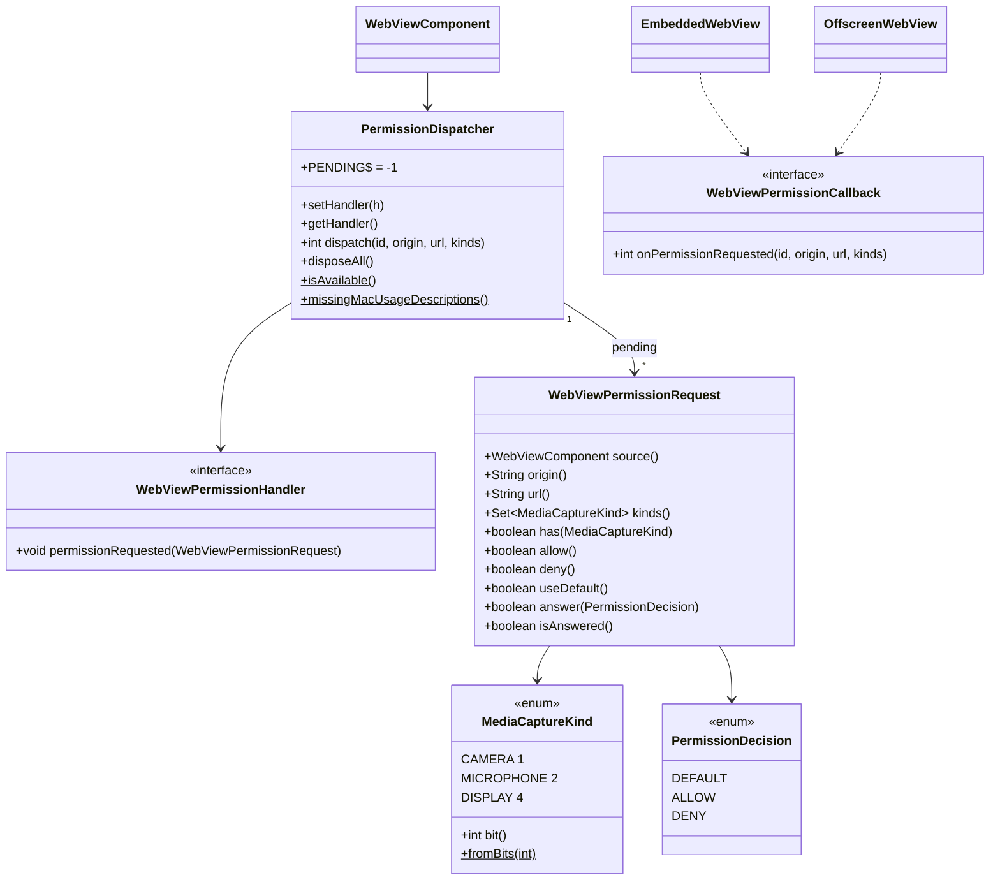

# REASONS Canvas: Decide Camera, Microphone And Screen-Capture Requests — Java API, Linux, macOS and Windows (011-001)

> Source story: `requirements/[User-story-11]decide-camera-microphone-and-screen-capture-requests.md` →
> **[STORY-011-001]**.
> Analysis: `spdd/analysis/GGQPA-XXX-202610150300-[Analysis]-decide-camera-microphone-and-screen-capture-requests.md`.
>
> The wiring follows the navigation decision (Canvas 34: handler, dispatcher, JNI callback, one global
> ref per engine installed at attach); the asynchronous answer follows custom schemes (Canvas 30–32: a
> pending table keyed by id, answered from any thread, marshalled to the engine thread, first answer
> wins). All three engines are in one Canvas because the value is one portable decision point.
> **Amends Canvas 33's** `run-linux-media-smoketest.sh`, which now also runs this Canvas's smoke test.

## REASONS-Implements

**Java (`src/ca/weblite/webview/`)**
- **New:**
  - `WebViewPermissionHandler`: the application's decision (D1);
  - `WebViewPermissionRequest`: what the handler is told, and how it answers (D2);
  - `MediaCaptureKind`: `CAMERA`, `MICROPHONE`, `DISPLAY`, with a bit-mask wire contract (D2);
  - `PermissionDecision`: `DEFAULT`, `ALLOW`, `DENY`, with an ordinal wire contract (D2);
  - `WebViewPermissionCallback`: the JNI-facing interface (D5);
  - `PermissionDispatcher`: per-component; fast path, pending table, EDT delivery, disposal (D3, D4).
- **Edited:**
  - `WebViewNative`: `webview_permission_available`, `webview_permission_respond`,
    `webview_embed_set_permission_callback`, `webview_offscreen_set_permission_callback` (D5);
    `webview_mac_missing_usage_descriptions` (D13);
  - `PermissionDispatcher`: static `missingMacUsageDescriptions()` and its package-private key mapping
    (D13);
  - `EmbeddedWebView` and `OffscreenWebView`: `setPermissionCallback` (D5);
  - `swing/WebViewComponent`: `setPermissionHandler`, `getPermissionHandler`,
    `isPermissionHandlerSupported()` (D1, D6), `missingMacUsageDescriptions()` (D13);
  - `swing/WebViewHeavyweightComponent` and `swing/WebViewLightweightComponent`: install the callback at
    attach, before the first navigation; dispose the dispatcher (D5).

**Native**
- **Edited** `src_c/webkit_loader.h` (added to `WK_WEBKIT_OPT_SYMS`, which `webkit_loader.cpp` already
  resolves optionally) and `src_c/webkit_shim.h`: optional media-permission symbol groups (D7a).
- **Edited** `src_c/webview_embed.cpp`: the GTK `permission-request` handler and media settings on
  `Engine` and `OffEngine` (D7); the Cocoa `requestMediaCapturePermissionForOrigin…` selector (D8) and
  its Info.plist usage-description safeguard (D13); the WKWebView media preferences on the
  configuration, for the engine and popup children (D12); the shared JNI bridges (D5, D13).
- **Edited** `windows/webview_embed.cc`: `PermissionRequested` on the engine and an adopted child, and the
  JNI bridges (D9).

**Tests (JUnit 4, headless)**
- **New** `test/ca/weblite/webview/PermissionDispatcherTest.java`.

**Demo, smoke test and docs**
- **New** `demos/WebViewMediaPermissionDemo/` (source + README), `run-linux-media-permission-demo.sh`,
  `run-mac-media-permission-demo.sh`, `run-windows-media-permission-demo.bat`.
- **New** `demos/WebViewMediaPermissionDemo/mac/launcher.c`: the in-process launcher of the demo's
  minimal `.app` bundle (D14); `run-mac-media-permission-demo.sh` builds and uses it.
- **New** `demos/WebViewMediaSmokeTest/src/ca/weblite/webview/demos/WebViewMediaPermissionSmokeTest.java`.
- **Edited** `run-linux-media-smoketest.sh` and `demos/WebViewMediaSmokeTest/README.md` (D11).
- **Edited** `README.md` (a "Camera, microphone and screen capture" section and a demo entry, including
  the macOS private-preference notes of D12 and the host-app checklist of D13) and `docs/index.html`
  (a demo card).
- **Edited** `demos/WebViewMediaPermissionDemo/README.md` (macOS notes of D12, the host-app checklist
  of D13, the bundled and `--no-bundle` runs of D14).

## Decisions (resolved here)

- **D1 · `WebViewPermissionHandler`.**
  - One method, `void permissionRequested(WebViewPermissionRequest request)`. The handler answers through
    the request, now or later, from any thread.
  - **No handler is the default.** `getPermissionHandler()` returns `null` until one is set, and
    `setPermissionHandler(null)` removes it. With no handler, every request goes to the engine exactly
    as before this Canvas (D3 fast path). Unlike the dialog and download handlers there is no library
    UI to fall back to, so `null` means "the engine decides", not "refuse".
  - **Threading:** the handler runs on the **Swing EDT**, delivered with `SwingUtilities.invokeLater`.
    Nothing waits for it to return, so it may show a modal dialog, and it may also return at once and
    answer later from any thread. It must not block the EDT for long.
  - **Asked about:** camera, microphone and screen-capture requests only. Geolocation, notifications and
    every other permission stay with the engine.

- **D2 · `WebViewPermissionRequest`** (final; its answer state is thread-safe):
  - `source()` the component; `origin()` the requesting origin `scheme://host[:port]` (canonicalised by
    `Origins.canonical`; derived from `url()` when the engine reports no origin; empty when there is
    none, e.g. `about:blank`); `url()` the address the engine reports (never null; may be empty);
    `kinds()` an unmodifiable `Set<MediaCaptureKind>` (never empty for a dispatched request);
    `has(MediaCaptureKind)`.
  - Answers: `allow()`, `deny()`, `useDefault()` and `answer(PermissionDecision)` (null means `DENY`).
    Each returns `true` when it was the first answer and so took effect, `false` otherwise.
    `isAnswered()`.
  - **`MediaCaptureKind`**: `CAMERA` (bit 1), `MICROPHONE` (bit 2), `DISPLAY` (bit 4); `bit()`,
    `static Set<MediaCaptureKind> fromBits(int)` (unknown bits ignored).
  - **`PermissionDecision`**: `DEFAULT` (0), `ALLOW` (1), `DENY` (2). The ordinals are the wire contract;
    never reorder. The JNI "pending" answer is `-1` (`PermissionDispatcher.PENDING`), not a decision.

- **D3 · `PermissionDispatcher.dispatch(long id, String origin, String url, int kindBits)`** returns an
  `int`, inline on the calling (native UI) thread, and never blocks:
  - disposed → `DENY` (2);
  - no handler → `DEFAULT` (0) without building a request — the **fast path**, which tells native to
    leave the request to the engine untouched;
  - no known kind in `kindBits` → `DEFAULT` (0);
  - otherwise: build the request, put it in the pending table under `id`, schedule
    `handler.permissionRequested(request)` with `invokeLater`, and return `PENDING` (-1). A handler that
    throws has the throwable forwarded to the default uncaught-exception handler and the request
    denied (a no-op if it had already answered).
  - **The first answer wins** (`AtomicBoolean` CAS); it removes the request from the table and sends
    `(id, ordinal)` to the **sink** — `WebViewNative.webview_permission_respond` by default, a recorder in
    tests. A sink that throws is reported, never rethrown.

- **D4 · Disposal.** `disposeAll()` marks the dispatcher disposed and **denies** every pending request
  (AC7). Native also drains its own table for a destroyed engine (D7–D9), so a request whose answer never
  arrives can't leak or hang the page past its component.

- **D5 · Wiring.**
  - **`WebViewPermissionCallback.onPermissionRequested(long id, String origin, String url, int kinds)`**
    returns `int` (`-1` pending, else a `PermissionDecision` ordinal).
  - **`WebViewNative`:** `static native boolean webview_permission_available()`;
    `static native void webview_permission_respond(long id, int decision)`;
    `webview_embed_set_permission_callback(long, WebViewPermissionCallback)`;
    `webview_offscreen_set_permission_callback(long, WebViewPermissionCallback)`.
  - **`EmbeddedWebView` and `OffscreenWebView`** gain `setPermissionCallback`, anchoring the callback in
    `heap` and absorbing `UnsatisfiedLinkError` (an older native keeps working without the feature).
  - **Both components install the callback at attach, before the first navigation,** beside the
    navigation callback; adopted popups get it the same way, and `dispose` calls
    `permissionDispatcher.disposeAll()`.
  - **Native contract, all engines:**
    1. Allocate an id from one process-wide counter and record the engine's request (retained) in a
       process-wide pending table, tagged with its engine, **before** calling Java.
    2. Call Java on the engine thread. A pending exception is cleared and treated as `DENY`.
    3. On an immediate answer, remove the entry and apply the answer at once.
    4. On `PENDING`, keep it. `webview_permission_respond` (any thread) posts to the engine thread, which
       looks the id up **at run time**, removes it and applies the answer. Because the post can only run
       after the handler returned, the entry is always complete by then. An unknown id is ignored (first
       answer wins; already drained).
    5. On engine destroy, the engine's entries are removed and **denied** on the engine thread before the
       view is torn down.

- **D6 · `WebViewComponent.isPermissionHandlerSupported()`** answers
  `WebViewNative.webview_permission_available()`, false on any `Throwable` (an older native). A native
  built with this Canvas answers true on all three platforms.

- **D7 · Linux (WebKitGTK), on `Engine` and `OffEngine`.**
  - **D7a · Loader.** A new optional group, `WK_OPT_MEDIA` (headers ≥ 2.8):
    `webkit_permission_request_allow`, `webkit_permission_request_deny`,
    `webkit_user_media_permission_request_get_type`, `webkit_user_media_permission_is_for_audio_device`,
    `webkit_user_media_permission_is_for_video_device`; and `WK_OPT_2_42` (headers ≥ 2.42):
    `webkit_user_media_permission_is_for_display_device`. Each gets a shim redirect inside the same
    `#if`. `webview_permission_available()` stays true; when the runtime lacks the core four (`allow`,
    `deny`, `get_type`, `is_for_audio_device`/`_video_device`), the handler returns FALSE (engine
    default) without asking Java.
  - **D7b · Signal.** One static function,
    `gtk_handle_permission_request(JavaVM*, jobject cb, void *engine, WebKitWebView*, WebKitPermissionRequest*)`,
    reached through per-engine wrappers connected to `"permission-request"` at view creation (so adopted
    popups, which go through the same creation function, are covered). It:
    - returns FALSE unless the request is a user-media request: `G_TYPE_CHECK_INSTANCE_TYPE(request,
      webkit_user_media_permission_request_get_type())` through the loader;
    - computes kinds: `is_for_display_device` (when resolved) → `DISPLAY` only; otherwise
      `is_for_video_device` → `CAMERA`, `is_for_audio_device` → `MICROPHONE`; none → FALSE;
    - with no callback → FALSE;
    - url = `webkit_web_view_get_uri(view)`, origin = empty (WebKitGTK reports no origin; Java derives it
      from the page address);
    - follows D5: `g_object_ref` for the table; immediate `DEFAULT` → unref, return FALSE (WebKit's own
      handler runs, which denies); immediate `ALLOW`/`DENY` → apply, unref, return TRUE; pending →
      return TRUE.
    - Applying `DEFAULT` after pending **denies** — WebKitGTK's own default once the signal is claimed.
  - **D7c · Settings.** At view creation, on both engines, `gtk_apply_media_settings(WebKitSettings*)`
    sets `enable-media-stream` and `enable-webrtc` to TRUE, and `enable-mock-capture-devices` to TRUE
    only when the environment variable `WEBVIEW_MOCK_CAPTURE_DEVICES` is `1` (a test hook, not API).
    Each is set through `g_object_set` only after `g_object_class_find_property` finds it, so older
    WebKitGTK skips what it lacks with no warning and no loader symbol.
  - **D7d · WebRTC availability** is not probed natively: `enable-webrtc` reads back TRUE on a build
    without WebRTC (Ubuntu 24.04's 2.52.6). A page detects it with `typeof RTCPeerConnection ===
    'function'`; documented in the README.
  - **D7e · Respond / drain** run on the GTK pump thread (`GtkPump::run_async`). Destroy disconnects the
    signal (`g_signal_handlers_disconnect_by_func`) and drains inside the `run_sync` that destroys the
    window, before `gtk_widget_destroy`.
  - **D7f · Linux is lightweight only.** Verification is in the lightweight component (`OffEngine`,
    Canvas 33's hidden popup toplevel). The `Engine` path carries the same hook only so the two GTK
    engines stay alike; it is never run, tested or verified on Linux (see `CLAUDE.md`).

- **D8 · macOS (WKWebView, macOS 12+).**
  - The delegate class adds `webView:requestMediaCapturePermissionForOrigin:initiatedByFrame:type:decisionHandler:`
    (type `v@:@@@q@`), registered only when `__builtin_available(macOS 12.0, *)`; on older macOS the
    selector is never added and WebKit behaves as before.
  - Kinds from `WKMediaCaptureType`: 0 → `CAMERA`; 1 → `MICROPHONE`; 2 → both; anything else → answer
    Prompt at once.
  - Origin from the `WKSecurityOrigin`: `protocol://host` plus `:port` when `port` is non-zero; url from
    `frame.request.URL.absoluteString`.
  - **D13's usage-description check runs first**, for every camera or microphone request, handler or
    not; a host missing a required key is denied there and nothing below runs.
  - With no engine, no callback, or a destroyed engine → `decisionHandler(WKPermissionDecisionPrompt)` —
    exactly what WebKit does when the delegate doesn't implement the selector.
  - Otherwise D5 with the handler block `copy`'d into the table; Java is called on AppKit main (the
    dispatcher never blocks). Decisions: `ALLOW` → Grant (1), `DENY` → Deny (2), `DEFAULT` → Prompt (0).
    Respond and drain run with `dispatch_async` on the main queue; the block is released after it is
    called.
  - **Screen capture** has no public WKWebView hook; `getDisplayMedia` keeps WebKit's own behaviour
    (D12 only makes the API available where WebKit has the private switch).
  - **Info.plist:** a host app must declare `NSCameraUsageDescription` and
    `NSMicrophoneUsageDescription`; without them macOS terminates the process (TCC, `SIGABRT`) when
    WebKit first opens the device. D13 turns that into a clean deny; D14 gives the demo a bundle that
    declares both. The OS's own consent prompt still appears once per app, on top of the handler's
    answer.

- **D9 · Windows (WebView2, SDK 1.0.2592.51).**
  - `PermissionRequestedHandler` (`ICoreWebView2PermissionRequestedEventHandler`, `Engine*`) registered
    with `add_PermissionRequested` beside `win_register_navigation`, for a fresh engine and an adopted
    child; its token is stored on the engine and removed on destroy.
  - Kinds: `COREWEBVIEW2_PERMISSION_KIND_CAMERA` → `CAMERA`, `_MICROPHONE` → `MICROPHONE`; any other kind
    returns `S_OK` untouched. The SDK has no screen-capture kind; `getDisplayMedia` keeps WebView2's own
    picker.
  - url = `get_Uri` (the requesting frame's address); origin = empty (derived in Java).
  - With no callback → `S_OK` untouched (WebView2's own prompt).
  - Otherwise D5: the entry holds `args` (AddRef'd), the engine and the worker thread id. Immediate
    answer → `put_State` (`ALLOW` → `COREWEBVIEW2_PERMISSION_STATE_ALLOW`, `DENY` → `_DENY`, `DEFAULT` →
    leave it), done. Pending → `GetDeferral` stored in the entry; respond posts to the worker thread
    (`post_to_worker_thread`), which puts the state, `Complete()`s and releases. `DEFAULT` after
    pending leaves the state at `COREWEBVIEW2_PERMISSION_STATE_DEFAULT`, which WebView2 resolves with
    its own behaviour. A failed `GetDeferral` denies at once.
  - Drain: `destroy_engine` posts a drain to the worker thread **before** `WM_EMBED_QUIT` (or runs it
    through `dispatch_to_thread` for a shared-thread adopted engine), so it runs first.

- **D10 · Demo.** `WebViewMediaPermissionDemo` serves `demo://app/` from a custom scheme (a secure
  context), with buttons for camera, microphone, both, and screen. Its handler shows a Swing
  `JOptionPane` (Allow / Deny / Default) for each request — answered asynchronously after the dialog —
  and logs origin, url and kinds. The page shows the stream in a `<video>`, the error name on refusal,
  and whether `RTCPeerConnection` exists. Run scripts per OS mirror the navigation demo's;
  `WEBVIEW_MOCK_CAPTURE_DEVICES=1` is exported by the Linux script when `MOCK=1` is set. At start the
  demo also logs `missingMacUsageDescriptions()` (D13); the macOS script runs it from a bundle (D14).

- **D11 · Linux smoke test.** `WebViewMediaPermissionSmokeTest` (exits 0 on pass, 1 on fail, one line
  per check), run by `run-linux-media-smoketest.sh` after Canvas 33's test, with
  `WEBVIEW_MOCK_CAPTURE_DEVICES=1`. The script exits non-zero if either fails. It registers scheme
  `permtest`, whose page exposes `window.ask(constraints, display)` storing the outcome
  (`ok:<track kinds>` or `err:<error name>`) in `window.__result`, and runs phases, each in a fresh
  lightweight component in one `JFrame`:
  1. **deny** — handler denies; `{video:true}` → `err:NotAllowedError`; kinds = `[CAMERA]`, origin
     `permtest://app`.
  2. **allow** — handler allows; `{video:true,audio:true}` → `ok:` with `audio` and `video`; kinds
     `[CAMERA, MICROPHONE]`.
  3. **later** — handler answers allow 1.5 s later from a timer thread; `{audio:true}` → `ok:audio`; the
     EDT stays responsive (an `invokeAndWait` no-op completes within 500 ms during the wait).
  4. **no handler** — `{video:true}` → `err:NotAllowedError` (WebKitGTK's default).
  5. **default** — handler answers `useDefault()` → `err:NotAllowedError`.
  6. **display** (informational) — handler allows; `getDisplayMedia({video:true})`; PASS when the
     handler saw `[DISPLAY]`, SKIP (not a failure) when no request reached it within 5 s, e.g. with
     WebKitGTK < 2.42 or no display-capture backend under Xvfb.
  7. **webrtc** (informational) — prints `typeof RTCPeerConnection`.

- **D12 · macOS: expose `navigator.mediaDevices` in the embedded WKWebView.**
  - **Why.** A WKWebView in an ordinary embedding app (not Safari) leaves WebKit's private preference
    `_mediaDevicesEnabled` off, so `navigator.mediaDevices` is `undefined`: `getUserMedia` throws a
    `TypeError` in the page and D8's delegate is never reached. Observed on a Mac with the demo in
    the heavyweight component: secure context true, `RTCPeerConnection` present, handler supported,
    `md.getUserMedia` undefined.
  - **What.** One native helper takes a `WKWebViewConfiguration`, reads its `preferences`, and turns on,
    each only if the preferences object `respondsToSelector:` the setter:
    `_setMediaDevicesEnabled:` (exposes `navigator.mediaDevices`), `_setMediaStreamEnabled:`
    (`getUserMedia` itself) and `_setScreenCaptureEnabled:` (`getDisplayMedia`). A missing selector is
    skipped silently, leaving that WebKit version exactly as before (no `mediaDevices`). Never
    key-value coding on these keys: `setValue:forKey:` on a key the class doesn't have throws
    `NSUnknownKeyException` and would crash the app on a WebKit without it.
  - **When.** On the engine's configuration **before** `initWithFrame:configuration:` (the web view
    takes its preferences from the configuration at init), right after the custom schemes are
    installed. Popup children are created from the configuration WebKit hands the UI delegate, which
    is derived from the opener's and carries its preferences; the helper is applied to it as well,
    before the child's `initWithFrame:configuration:`, so a child is covered whatever WebKit copies.
  - **Always on, not opt-in.** `mediaDevices` is exposed whether or not a permission handler is set.
    With no handler, D8 answers Prompt and WebKit shows its own permission prompt — the same as
    Windows, where WebView2's prompt is the default. An opt-in would leave the documented default
    ("WebKit's own permission prompt") unreachable. The cost, recorded: a page can now reach the
    capture devices in any host, so the **host must declare `NSCameraUsageDescription` and
    `NSMicrophoneUsageDescription`**. Observed on macOS 15.4.1 (arm64) from a plain `java`: WebKit does
    *not* refuse a host that lacks them; after a grant it opens the camera and macOS's privacy system
    kills the process (`SIGABRT`, namespace TCC). D13 is the safeguard. An application that must never
    expose the devices denies in its handler.
  - **Screen capture.** `_setScreenCaptureEnabled:` makes `getDisplayMedia` available where WebKit has
    it; whether a request then reaches D8's delegate depends on the WebKit version (there is no public
    display-capture hook), so screen capture stays WebKit's decision as D8 says.
  - **Other macOS paths.** macOS has no offscreen engine (the lightweight entry points are stubs
    there) and creates no other `WKWebViewConfiguration`; the engine and popup children are the only
    places.
  - **Private API.** These are private WebKit preferences, the same category as the existing
    `developerExtrasEnabled` used in debug mode: fine for applications distributed outside the Mac App
    Store; App Store review may reject private API use. Documented in the README and the demo's README.

- **D13 · macOS: never let a page reach a device the host has no usage description for.**
  - **Why.** Observed on macOS 15.4.1 (arm64), demo run through a plain `java` with "Always allow":
    D8 granted, WebKit opened the camera on a dispatch-queue thread, and macOS terminated the process
    (`EXC_CRASH (SIGABRT)`, termination namespace TCC, "…must contain an NSCameraUsageDescription
    key"). The `java` launcher's main bundle has no usage strings, and neither has any host that
    forgot them. A crash is never an acceptable answer to a web page.
  - **Check.** Native helper `cocoa_media_missing_kinds(int kinds)` returns the subset of `kinds` whose
    key the main bundle lacks: `CAMERA` needs `NSCameraUsageDescription`, `MICROPHONE` needs
    `NSMicrophoneUsageDescription` (camera-and-microphone needs both). A key counts as present only
    when `[[NSBundle mainBundle] objectForInfoDictionaryKey:]` is an `NSString` of non-zero length
    (TCC wants a string). It is evaluated per request (one dictionary lookup per key).
  - **Where.** In D8's delegate, right after the kinds are computed and before the no-handler test.
    When anything is missing it answers `WKPermissionDecisionDeny` at once, writes one line to stderr,
    and **does not call Java**. It never answers Prompt there: WebKit's prompt-then-grant reaches the
    same TCC kill, so the **no-handler path is covered too**. The page sees `NotAllowedError`.
  - **Why Java is not asked.** No answer could change the outcome; a handler that asks the user would
    show a dialog whose "Allow" is then silently overruled. The host learns about the problem up
    front from `missingMacUsageDescriptions()` and, per request, from the stderr line.
  - **Second line of defence.** Each pending entry also records its kinds, and the function that calls
    the decision block re-checks: any non-deny answer (`ALLOW` or `DEFAULT`) for kinds with a missing
    key is turned into Deny with the same stderr line. The main bundle does not change during a
    process, so this is normally unreachable; it is kept because it costs one lookup and it guards
    the later dispatch (`cocoa_perm_respond`) as well as the immediate answer.
  - **Message**, one line, per denied request, naming the requested devices and the missing keys:
    `swingwebview: camera access denied — this app's Info.plist has no NSCameraUsageDescription (macOS
    would terminate the app)`; the device words are `camera`, `microphone`, or `camera and microphone`,
    and several missing keys are joined with ` and `.
  - **Java helper.** `WebViewComponent.missingMacUsageDescriptions()` (static) returns an unmodifiable
    `List<String>` of the usage-description key names the running process's main bundle lacks, camera
    key first; empty when not on macOS or when the loaded native predates the probe. It delegates to
    `PermissionDispatcher.missingMacUsageDescriptions()`, which calls
    `WebViewNative.webview_mac_missing_usage_descriptions()` only when `os.name` starts with `Mac`
    (`int`, the `MediaCaptureKind` bits whose key is missing — the same native helper as the
    delegate, asked about camera and microphone; `0` on every other native) and maps the bits with a
    package-private `usageDescriptionKeys(int)`; any `Throwable` gives the empty list. A host can
    check at start and warn, or hide its video features.
  - **Screen capture** is not checked: `getDisplayMedia` uses macOS's Screen Recording privacy
    service, which has no Info.plist usage-description key and does not terminate a process that
    lacks one (macOS asks the user, or the user grants it in System Settings › Privacy & Security ›
    Screen & System Audio Recording). It also never reaches D8 with a public type; the delegate's
    unknown-type branch keeps answering Prompt.

- **D14 · macOS demo launcher: a minimal `.app` whose main bundle carries the keys.**
  - **Why a native launcher.** `NSBundle mainBundle` follows the executable, so a shell-script `.app`
    that execs the system `java` still gets `java`'s (empty) bundle, and a launcher that spawns `java`
    as a child makes a separate process with the same problem. The JVM must run **in** a process whose
    executable belongs to the bundle.
  - **Choice: a clang-built launcher with an embedded `__info_plist`, calling the JDK's `JLI_Launch`
    in-process.** Rejected: `jpackage` (JDK 14+ only, slow, copies or links a runtime, needs a
    `--resource-dir` Info.plist override — more moving parts for a demo) and a raw
    `JNI_CreateJavaVM` launcher (it would have to reproduce what libjli does on macOS: start the JVM
    on a second thread and park the first thread in the Cocoa run loop for AWT, parse `-cp` and the
    other options, find the JDK). `JLI_Launch` is the entry point the `java` command and jpackage's own
    launcher use, so the process starts exactly like `java` does.
  - **`demos/WebViewMediaPermissionDemo/mac/launcher.c`:** reads `JAVA_HOME` from the environment,
    `dlopen`s the first existing of `$JAVA_HOME/lib/libjli.dylib`, `$JAVA_HOME/lib/jli/libjli.dylib`,
    `$JAVA_HOME/jre/lib/jli/libjli.dylib`, looks up `JLI_Launch`, and calls it with its own `argc`/`argv`
    as the `java` command would (no extra JVM args, wildcard classpath on, not `javaw`, default
    ergonomics). libjli re-enters the executable's `main` on its new thread; `main` is re-entrant
    (same lookups, libjli's own guard stops the recursion). Any failure prints one
    `swingwebview-launcher:` line to stderr and exits 1.
  - **Bundle,** built by `run-mac-media-permission-demo.sh` under
    `build/WebViewMediaPermissionDemo.app`: `Contents/Info.plist` (`CFBundleIdentifier`
    `ca.weblite.webview.demos.mediapermission`, `CFBundleExecutable`, `CFBundleName`,
    `CFBundlePackageType` `APPL`, `LSMinimumSystemVersion` 12.0, `NSHighResolutionCapable`,
    `NSCameraUsageDescription`, `NSMicrophoneUsageDescription`) and `Contents/MacOS/` holding the
    launcher, linked with the same plist as `-sectcreate __TEXT __info_plist` (so the keys are present
    even if the executable is copied out of the bundle). Then `codesign --force --sign -` on the bundle
    when `codesign` exists. Rebuilt when `launcher.c` or the script is newer than the executable.
  - **Run.** The script `exec`s `Contents/MacOS/<launcher>` directly (not `open`), so the terminal
    keeps stdout/stderr and the environment, with the demo's classpath and main class.
  - **Flags.** `--no-bundle` keeps the old plain-`java` launch, to demo D13: Camera is denied with the
    stderr line and `NotAllowedError` instead of a crash. `--print-info-plist` prints the generated
    Info.plist and exits; it runs on any OS (the plist generation is checked on Linux). Unknown
    arguments print the usage and exit 2.
  - **Defensive.** Not macOS → an error (except `--print-info-plist`); no `clang` → an error that
    suggests `xcode-select --install` or `--no-bundle`; a `JAVA_HOME` without `javac` or without
    libjli → an error naming the path; `plutil -lint` checks the plist when present.

## R · Requirements
- Let an application decide every camera, microphone and screen-capture request from the pages it hosts —
  allow, deny, or leave it to the engine — answering whenever it is ready, on all three engines.
- Make media capture and WebRTC available on Linux where the engine provides them.
- Change nothing for an application that installs no handler.

## E · Entities

## A · Approach
1. **Navigation's wiring, schemes' answering:** handler → dispatcher → JNI callback installed at attach;
   a pending table keyed by id on both sides, answered from any thread, applied on the engine thread.
2. **The engine thread never waits:** Java returns "pending" at once and the handler runs on the EDT
   via `invokeLater`.
3. **No handler is the engine's own path**, decided synchronously inside the engine's hook, with nothing
   left pending.
4. **Fail closed on errors** (throw, JNI exception, disposal, failed deferral) by denying; **fail to the
   engine's default** only where nothing was installed.
5. **Optional symbols and property lookups** on Linux, `__builtin_available` on macOS, the SDK's own
   kinds on Windows: older engines keep working.

## S · Structure
1. The new Java types sit in `ca.weblite.webview` beside the navigation types; `PermissionDispatcher` is
   public only because the Swing subclasses live in another package.
2. Native code per platform: one static handler, one pending table with respond + drain, per-engine
   wrappers, setters and JNI bridges, next to the navigation code in each file.
3. `webview_permission_available` and `webview_permission_respond` are process-wide; the setters are
   per engine.

## O · Operations
1. **`MediaCaptureKind`, `PermissionDecision`, `WebViewPermissionHandler`, `WebViewPermissionRequest`,
   `WebViewPermissionCallback`**, per D1, D2 and D5.
2. **`PermissionDispatcher`**, per D3 and D4: constructor `(WebViewComponent)` using the native sink, a
   package-private `(WebViewComponent, Sink, Executor edt)` for tests (`Sink.respond(long id, int
   decision)`; `edt` defaults to `SwingUtilities::invokeLater`); `pendingCount()` for tests.
3. **`WebViewNative`, `EmbeddedWebView`, `OffscreenWebView`**, per D5.
4. **`WebViewComponent`** (field `permissionDispatcher`, setter, getter, `isPermissionHandlerSupported`)
   and **both components** (attach, dispose), per D5 and D6.
5. **Linux**, per D7; **macOS**, per D8, D12 and D13; **Windows**, per D9.
6. **`PermissionDispatcherTest`:**
   - no handler → `DEFAULT`, nothing pending, handler never built;
   - disposed → `DENY`;
   - unknown kind bits → `DEFAULT`;
   - a handler gets origin, url and kinds (`permtest://app/x` → origin `permtest://app`; bits 3 →
     `[CAMERA, MICROPHONE]`) and its `allow()` reaches the sink as `(id, 1)`;
   - an explicit engine origin wins over the url;
   - first answer wins (allow then deny → one sink call, `ALLOW`; second returns false);
   - `answer(null)` denies;
   - a throwing handler denies and reaches the uncaught handler;
   - an answer from another thread after a delay reaches the sink;
   - `disposeAll()` denies every pending request;
   - `MediaCaptureKind.fromBits` ignores unknown bits;
   - `usageDescriptionKeys`: 0 → empty; 1 → `[NSCameraUsageDescription]`; 2 →
     `[NSMicrophoneUsageDescription]`; 3 and 7 → both, camera first; the list is unmodifiable;
   - `missingMacUsageDescriptions()` is empty off macOS (the test JVM's `os.name` decides; skipped on a
     Mac).
7. **Demo, smoke test, run scripts, README, docs**, per D10 and D11; the macOS launcher and bundle per
   D14. The README and the demo's README state the macOS host-app requirements as a checklist: the two
   Info.plist keys, with jDeploy and jpackage examples; what happens without them (a clean deny with
   the stderr line, no crash); `missingMacUsageDescriptions()`; screen recording needing no key; and
   the private-preference note.
8. **Verification recorded in the PR:** the Linux native built and the smoke test run under Xvfb **in
   the lightweight component, the only Linux mode**; `mvn test`; Windows and macOS natives compiled by CI
   only — untested on device. For D13/D14 on Linux: the macOS section syntax-checked against stub
   headers, the run script checked with `bash -n`, and `--print-info-plist` parsed as a plist.

## N · Norms
1. The navigation Canvas's norms hold: Javadoc on every public type states the threading contract;
   dispatchers never throw to native; Java 8 source level.
2. Comments cite `Canvas 35 Dn`.
3. Native: C++11 on Linux/macOS, the files' existing styles; every JNI upcall attaches only when needed,
   clears pending exceptions, and deletes its local refs.
4. No release-version bump: `pom.xml` stays at its snapshot version (no Canvas or norm ties a feature to
   a version).

## S · Safeguards
1. **No change without a handler:** with no handler installed, every engine receives the request exactly
   as before (the GTK handler returns FALSE, releasing the transient table ref it took, so WebKit's own
   handler runs; WebView2 leaves the args untouched; WKWebView answers Prompt, its documented default).
   The deliberate exceptions are D12 (on macOS `navigator.mediaDevices` now exists, so the request
   reaches WebKit's default at all) and D13 (on macOS a host without the usage description is denied
   instead of prompted, because the prompt would end in a crash).
2. **Never block an engine thread or the EDT** waiting for the application.
3. **Exactly one answer reaches the engine** per request: first answer wins in Java; native removes the
   entry before applying it; drain and respond race safely because both remove under the table lock.
4. **Fail closed:** a throwing handler, a JNI exception, a failed deferral, or disposal denies.
5. **No new mandatory dependency:** Linux symbols are optional through the runtime loader; settings by
   property lookup; macOS selector added only on 12+; macOS private preference setters called only
   when `respondsToSelector:` says they exist (D12), never by key-value coding.
6. **Scope:** only camera, microphone and screen-capture requests are routed; every other permission kind
   is left to the engine untouched.
7. **Test-only switch:** mock capture devices only when `WEBVIEW_MOCK_CAPTURE_DEVICES=1`.
8. **Never crash the host for a page (macOS, D13):** a camera or microphone request whose usage
   description is missing from the main bundle is denied — with a handler or without one, before Java
   is asked, and again at the moment any answer is applied — and never answered Grant or Prompt.
