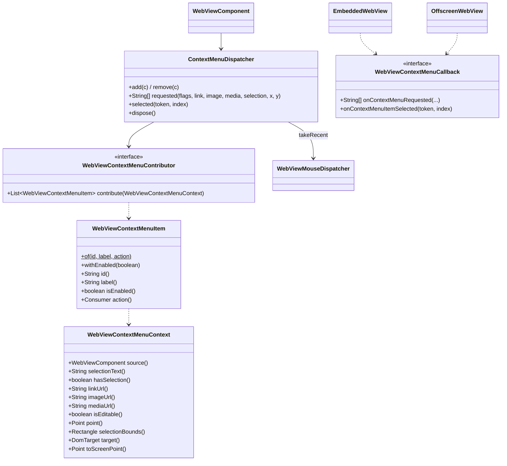

# REASONS Canvas: Add Application Items To The Native Context Menu — Java API, Linux, macOS and Windows (012-001)

> Source story: `requirements/[User-story-12]add-application-items-to-the-native-context-menu.md` →
> **[STORY-012-001]**.
> Analysis: `spdd/analysis/GGQPA-XXX-202610191500-[Analysis]-add-application-items-to-the-native-context-menu.md`.
>
> Canvas 9 lets an application *replace* the engine's right-click menu. This Canvas adds the *augment*
> model beside it: the engine's own menu still opens, with every native item, and the application's
> items are appended. It covers all three engines in one Canvas, like Canvases 34 and 35, because the
> value is one portable hook. It also fixes where the engine menu opens in the Linux lightweight
> component.

## REASONS-Implements

**Java (`src/ca/weblite/webview/`)**
- **New:**
  - `WebViewContextMenuContributor`: the application's hook (D1);
  - `WebViewContextMenuItem`: one contributed item (D2);
  - `WebViewContextMenuContext`: what the right-click hit (D3);
  - `WebViewContextMenuCallback`: the JNI-facing interface (D6);
  - `ContextMenuDispatcher`: per-component; asks contributors, remembers the shown menu, fires the
    chosen item on the EDT (D4, D5).
- **Edited:**
  - `WebViewMouseDispatcher`: the shim appends the selection rectangle and a text-control selection to
    its record; the dispatcher keeps the newest record for the context menu (D7);
  - `WebViewNative`: `webview_context_menu_available`, `webview_embed_set_context_menu_callback`,
    `webview_offscreen_set_context_menu_callback`, `webview_offscreen_set_screen_origin` (D6, D9);
  - `EmbeddedWebView` and `OffscreenWebView`: `setContextMenuCallback`; `OffscreenWebView.setScreenOrigin`
    (D6, D9);
  - `swing/WebViewComponent`: `addContextMenuContributor`, `removeContextMenuContributor`,
    `isContextMenuContributionSupported()` (D1, D8);
  - `swing/WebViewHeavyweightComponent` and `swing/WebViewLightweightComponent`: install the callback at
    attach, dispose the dispatcher; the lightweight component reports its screen origin and forwards
    a right-button press at release (D6, D9, D9b).

**Native**
- **Edited** `src_c/webkit_loader.h` and `src_c/webkit_shim.h`: an optional context-menu symbol group
  (D9).
- **Edited** `src_c/webview_embed.cpp`: the GTK `context-menu` hook on `Engine` and `OffEngine`, the
  lightweight menu placement (D9); the Cocoa `willOpenMenu:withEvent:` hook (D10); the JNI bridges (D6).
- **Edited** `windows/webview_embed.cc`: `ContextMenuRequested` on the engine and an adopted child, and
  the JNI bridges (D11).

**Tests (JUnit 4, headless)**
- **New** `test/ca/weblite/webview/ContextMenuDispatcherTest.java`.

**Demo and docs**
- **New** `demos/WebViewNativeContextMenuDemo`, `run-linux-native-context-menu-demo.sh`,
  `run-mac-native-context-menu-demo.sh` and `run-windows-native-context-menu-demo.bat`.
- **Edited** `README.md`.

## Decisions (resolved here)

- **D1 · `WebViewContextMenuContributor`** (`@FunctionalInterface`).
  - One method: `List<WebViewContextMenuItem> contribute(WebViewContextMenuContext context)`. `null` or
    an empty list adds nothing.
  - **Threading: the popup/navigation contract.** It runs on the engine's UI thread, synchronously, off
    the EDT, while the engine waits to open its menu. It must be fast and must not touch Swing. The
    chosen item's action runs later, on the EDT.
  - `WebViewComponent.addContextMenuContributor(c)` / `removeContextMenuContributor(c)` (both `final`,
    return `this`, usable before or after attach; add rejects null with `NullPointerException("contributor")`,
    remove ignores null). Contributors are asked in registration order; adding the same instance twice
    asks it twice.
  - **Precedence with Canvas 9:** contributors only ever add to the engine's menu. When the engine menu
    is suppressed (a `WebViewMouseListener` with no `setDefaultContextMenuEnabled(true)`, or the page's
    own `preventDefault()`), no engine menu opens and contributors are not asked. With
    `setDefaultContextMenuEnabled(true)` both run: listeners are told and the engine menu opens with the
    contributed items.

- **D2 · `WebViewContextMenuItem`** (final, immutable).
  - `static of(String id, String label, Consumer<WebViewContextMenuContext> action)`; `withEnabled(boolean)`
    returns a copy; accessors `id()`, `label()`, `isEnabled()`, `action()`.
  - `id`, `label` and `action` are non-null (`NullPointerException` naming the parameter). `label` must
    be non-empty and contain no `U+0000` (`IllegalArgumentException`); it is plain text, shown as
    written (D9–D11 escape per platform). `id` is the caller's; the library never interprets it.
  - A disabled item is shown greyed and can never fire.

- **D3 · `WebViewContextMenuContext`** (final, immutable; package-private constructor).
  - `source()` — the component;
  - `selectionText()` — never null, `""` when none; `hasSelection()` — `!selectionText().isEmpty()`;
  - `linkUrl()`, `imageUrl()`, `mediaUrl()` — nullable;
  - `isEditable()`;
  - `point()` — the click in component coordinates (a fresh `Point`), or null when unknown;
  - `selectionBounds()` — the selection's rectangle in component coordinates (a fresh `Rectangle`), or
    null;
  - `target()` — the Canvas 9 `DomTarget` of the click, or null when no shim record matched (D7);
  - `toScreenPoint()` — `point()` converted with `SwingUtilities.convertPointToScreen`; null when
    `point()` is null or the component is not showing; call on the EDT.
  - **Untrusted data:** every field describes page content and may be shaped by page script; the
    Javadoc says so.

- **D4 · `ContextMenuDispatcher.requested(flags, linkUrl, imageUrl, mediaUrl, selectionText, x, y)`**
  returns the native wire answer (D6), inline on the calling thread.
  - It first **takes** the newest shim record no older than **2 000 ms** (D7), consuming it.
  - With no contributor, or after `dispose()`, it clears the shown menu and returns null.
  - **Context assembly** (`FLAG_LINK = 1`, `FLAG_IMAGE = 2`, `FLAG_MEDIA = 4`, `FLAG_EDITABLE = 8`,
    `FLAG_SELECTION = 16`, `FLAG_NATIVE = 256`):
    - with `FLAG_NATIVE` (the engine reported a hit test): link/image/media are the native strings when
      non-empty, else null; editable is `FLAG_EDITABLE`; the selection text is the native string when
      non-null, else — only when `FLAG_SELECTION` is set — the record's selection text (or its
      text-control selection when that is empty), else `""`;
    - without `FLAG_NATIVE`: every field comes from the record (link `linkHref`, image `imageSrc`, media
      `mediaSrc`, editable `isContentEditable`, selection as above but without the flag gate); no
      record means an empty context;
    - `point()` is the record's `clientX/clientY`, else the native `x, y` when both are ≥ 0, else null;
    - `selectionBounds()` is the record's rectangle when the context has a selection and the rectangle
      has a positive area, else null.
  - Each contributor is called in a `try`; a `Throwable` goes to the default uncaught-exception handler
    (or `printStackTrace`) and that contributor adds nothing. Null items in a list are skipped. At most
    **32** items are kept in total.
  - No items → clear the shown menu, return null. Otherwise record a new **shown menu** (a token from a
    per-dispatcher counter starting at 1, the items, the context), replacing any previous one, and
    return the wire answer.

- **D5 · `ContextMenuDispatcher.selected(token, index)`**.
  - Ignored unless the shown menu exists, has that token, and `0 ≤ index < items`. It then clears the
    shown menu with compare-and-set, so a menu fires **at most once**, and only the **newest** menu can
    fire.
  - A disabled item, or a disposed dispatcher, is ignored.
  - The item's action runs on the EDT (`invokeLater`, or inline when already there) inside a `try`; a
    `Throwable` goes to the uncaught-exception handler.
  - **There is no JavaScript path to `selected`:** only the native menu item calls it (AC7).

- **D6 · Wiring.**
  - **`WebViewContextMenuCallback`:**
    - `String[] onContextMenuRequested(int flags, String linkUrl, String imageUrl, String mediaUrl,
      String selectionText, int x, int y)`; JNI signature
      `(ILjava/lang/String;Ljava/lang/String;Ljava/lang/String;Ljava/lang/String;II)[Ljava/lang/String;`;
    - `void onContextMenuItemSelected(long token, int index)`; JNI signature `(JI)V`.
  - **Wire answer:** null, or a `String[]` whose element 0 is the token in decimal and each further
    element is one item: `'1'` (enabled) or `'0'` (disabled) followed by the raw label. Natives read
    elements with `GetStringChars` (UTF-16), never `GetStringUTFChars`, so labels with characters
    outside the BMP survive. An answer with fewer than two elements adds nothing.
  - **Natives append** one separator, then the items in order, after every engine item; each item
    remembers the token and its index; choosing it calls `onContextMenuItemSelected(token, index)`.
  - **`WebViewNative`:** `static native boolean webview_context_menu_available()`;
    `webview_embed_set_context_menu_callback(long, WebViewContextMenuCallback)`;
    `webview_offscreen_set_context_menu_callback(long, WebViewContextMenuCallback)`.
  - **`EmbeddedWebView` / `OffscreenWebView.setContextMenuCallback(cb)`** anchor `cb` in `heap` and
    catch `UnsatisfiedLinkError`, so an older native keeps working without the feature.
  - **Both components install the callback at attach**, beside the navigation callback, and call
    `contextMenuDispatcher.dispose()` in `dispose()`.
  - **Each engine holds one global ref,** replaced on set and deleted on destroy, like
    `navigation_callback`. Each native item holds what its activation needs (its own global ref to the
    callback, the token, the index), so activation never reads an engine that may be gone.

- **D7 · The Canvas 9 record, extended.**
  - The shim appends five fields after field 21 (the parser already tolerates trailing fields):
    `22 selX | 23 selY | 24 selW | 25 selH` — the client rectangle of the window selection's first range,
    integers, empty when there is no non-collapsed range — and `26 controlSelection` (base64) — when the
    target is an `<input>` (not `password`) or `<textarea>` with `selectionStart < selectionEnd`, that
    substring of its value, capped like the selection at 65 536 code units; else empty.
    `DomTarget.selectionText()` keeps its Canvas 9 meaning.
  - `WebViewMouseDispatcher.dispatch` stores the parsed event, the rectangle, the control selection and
    `System.nanoTime()` as the **newest record** before the EDT hop (an `AtomicReference`), whether or not
    listeners exist. `takeRecent(maxAgeMillis)` (package-private) returns it and clears it, or returns
    null when absent or older.
  - The record and the native menu request travel on the same engine connection, the record first, so
    on WebKitGTK and WKWebView the record is in place when the engine asks. A record forged by page
    script can only change the description; on GTK and WebView2 the presence of a selection, link or
    image comes from the engine (`FLAG_NATIVE`).

- **D8 · `WebViewComponent.isContextMenuContributionSupported()`** (static) answers
  `WebViewNative.webview_context_menu_available()`, false on `UnsatisfiedLinkError`. A native built with
  this Canvas answers true on all three platforms. (On Windows, a WebView2 runtime older than 1.0.1185
  has no `ContextMenuRequested`; the engine menu is then unchanged.)

- **D9 · Linux (WebKitGTK).**
  - **Loader:** an optional group under `WEBKIT_CHECK_VERSION(2, 18, 0)`:
    `webkit_context_menu_append`, `webkit_context_menu_item_new_from_gaction`,
    `webkit_context_menu_item_new_separator`, `webkit_hit_test_result_get_context`,
    `webkit_hit_test_result_get_link_uri`, `webkit_hit_test_result_get_image_uri`,
    `webkit_hit_test_result_get_media_uri`. The hook does nothing unless all resolve (`WK_HAS`).
  - **One shared handler, `gtk_handle_context_menu(jvm, cb, menu, event, hit)`,** connected to
    `"context-menu"` on every `Engine` and `OffEngine` view (fresh or adopted), through per-engine
    wrappers. It returns FALSE always, so WebKit shows its own menu.
    - Flags: `FLAG_NATIVE`, plus link/image/media/editable/selection from the hit-test context bits
      (`LINK`, `IMAGE`, `MEDIA`, `EDITABLE`, `SELECTION`); the three URIs from the hit test; selection
      text null (WebKitGTK has none); `x, y` from the button event, else −1.
    - For each item, a `GSimpleAction` named `weblite-ctx-<token>-<index>` (WebKit groups actions by
      name, so names must be unique), disabled when the item is, whose `activate` calls Java; the item
      is `webkit_context_menu_item_new_from_gaction(action, label, NULL)`.
    - **Labels:** UTF-16 → UTF-8 with `g_utf16_to_utf8`, then every `_` doubled (WebKit's GTK menu
      treats `_` as a mnemonic; markup is not interpreted).
    - The activation data (JavaVM, its own global ref, token, index) is freed with the action
      (`g_signal_connect_data` destroy notify), attaching the thread to delete the ref.
    - JNI: attach only if needed; a pending exception is cleared and the menu is left as WebKit built it.
  - **Lightweight placement** (fixes today's top-left menu):
    - Java reports the component's screen origin (`getLocationOnScreen()`) through
      `webview_offscreen_set_screen_origin(peer, x, y)` before forwarding each mouse press and each key
      press; the native stores it on the `OffEngine` on the GTK thread.
    - A `GtkMenu::popped-up` emission hook (installed once, keeping a ref on the `GtkMenu` class so the
      signal exists) acts only on menus attached to an `OffEngine`'s view (found through object data
      `weblite-off-engine` on the view, cleared on destroy) once an origin is known. It takes the
      pre-slide `flipped_rect` (root coordinates), subtracts the view's root origin, re-bases on the
      reported screen origin, flips left/up when the menu would leave the monitor's work area, clamps
      to it, and moves the menu's toplevel `GdkWindow` there.
    - Placement assumes GTK and Java logical pixels agree (same scale factor); documented.
  - **D9b · Secondary-button presses are forwarded at release.** While a mouse button is down, the X
    server holds an implicit pointer grab for the Swing window, so GTK cannot grab the pointer for
    WebKit's menu and silently skips the popup: today a right-press held longer than a few
    milliseconds (any human click) opens no menu at all (verified on the unchanged library). The
    lightweight component therefore holds a `BUTTON3` press and forwards it (with its own position,
    modifiers and click count), immediately followed by the release, when the release arrives. Other
    buttons are forwarded as before. Effect on pages: the DOM `mousedown`/`contextmenu` of a right
    button fire at release time, as on Windows; right-button drags are not forwarded.
  - **D9a · Linux is lightweight only.** **The supported and verified Linux component is the lightweight
    one (`OffEngine`); heavyweight is never run, tested or verified on Linux** (see `CLAUDE.md`). The GTK
    `Engine` carries the same `context-menu` hook only so the two GTK engines stay alike; it needs no
    placement fix (its view is on-screen).

- **D10 · macOS (WKWebView).**
  - **A class-wide hook on `WKWebView -willOpenMenu:withEvent:`**, installed once beside the click
    swizzle: `class_addMethod` adds it when `WKWebView` does not implement the method itself (the hook
    then calls `NSView`'s implementation through the superclass); otherwise `method_setImplementation`
    replaces WKWebView's own and the hook calls the original. Either way the original runs **first**.
  - The hook finds its `Engine` in `g_webview_map` (no-op for views the library does not own) and, with
    a callback set, asks Java on the main thread: flags 0 (no native hit test), null strings, and the
    point `[webView convertPoint:[event locationInWindow] fromView:nil]`, flipped against the bounds
    height when the view is not flipped.
  - It appends `[NSMenuItem separatorItem]` and, per item, an `NSMenuItem`
    (`initWithTitle:action:keyEquivalent:@""`, title from `stringWithCharacters:length:`) with target a
    shared `WebliteContextMenuTarget` instance (a runtime class with `webliteContextMenuItem:` and
    `validateMenuItem:` returning the item's `isEnabled`), `tag` = index, `representedObject` = the token
    as an `NSNumber`, and `setEnabled:`; each is released after `addItem:`.
  - **Activation** looks up the token in a global table (token → engine, global ref to the callback),
    filled when the menu is built, purged for an engine when it builds a newer menu and when it is
    destroyed, and calls Java on the main thread.
  - Titles are literal on macOS: no escaping.

- **D11 · Windows (WebView2).**
  - **`ContextMenuRequestedHandler`** (`ICoreWebView2ContextMenuRequestedEventHandler`, `Engine*`) is
    registered through `ICoreWebView2_11::add_ContextMenuRequested` beside `win_register_navigation`, for
    a fresh engine and an adopted child; its token is removed and the callback deleted on destroy. An
    older runtime (no `ICoreWebView2_11`) leaves it unregistered.
  - **`Invoke`:** with no callback, returns `S_OK`. Otherwise it reads `get_ContextMenuTarget`:
    `FLAG_NATIVE`; `get_IsEditable`; `get_HasLinkUri`/`get_LinkUri`; `get_HasSourceUri`/`get_SourceUri`
    as the image URL for kind `IMAGE` or the media URL for `AUDIO`/`VIDEO`; `get_HasSelection`/
    `get_SelectionText` (passed to Java with `NewString`, UTF-16). `x, y` from `get_Location`. It calls
    Java on the WebView2 thread.
  - **Items:** through `ICoreWebView2Environment9::CreateContextMenuItem` from the engine's
    `environment`: one `SEPARATOR` and one `COMMAND` per item, each inserted at the end of
    `get_MenuItems`; `put_IsEnabled`; `add_CustomItemSelected` with a `CustomItemSelectedHandler` that
    owns a global ref, the token and the index (deleted in its destructor).
  - **Labels:** `&` doubled (WebView2 labels mark access keys with `&`).

- **D12 · Demo.** `WebViewNativeContextMenuDemo` shows a page with a paragraph, a link, an image, a text
  field and a textarea, and contributes **Ask** (when there is a selection), **Open Link Externally…**
  (when there is a link), a disabled **Disabled sample**, and a label with `_`, `&` and markup. Chosen
  items are logged with their context. `NCMDEMO_AUTO=1` (or `-Dncmdemo.auto=true`) selects the paragraph,
  right-clicks it with a `java.awt.Robot`, captures the screen to `build/ncmdemo-menu.png`, chooses
  **Ask** from the keyboard (Up, Enter — in auto mode **Ask** is the only, hence last, item), checks
  that its action ran on the EDT with the selection text, rectangle and click point, prints
  `PASS`/`FAIL`, and exits 0/1. The Linux script runs the lightweight component only.

## R · Requirements
- Let an application add its own items to the engine's right-click menu, keeping every engine item.
- Tell the application, on the EDT, which item was chosen and what the click hit.
- Change nothing without a contributor, except that the Linux lightweight menu now opens, and opens at
  the pointer.

## E · Entities

## A · Approach
1. **Augment the engine's own menu object** on every engine; never rebuild native items.
2. **The navigation decision's shape, reused:** contributor, dispatcher, JNI callback, global ref, attach.
3. **Native facts first, the Canvas 9 record for the rest,** consumed once and only when fresh.
4. **Activation only from the native item, by token,** once, newest menu only.
5. **Fix the Linux lightweight menu**: move WebKit's own menu to the pointer after GTK has placed it,
   and forward right-button presses at release so GTK can grab the pointer (D9, D9b).

## S · Structure
1. The new Java types sit in `ca.weblite.webview` beside the Canvas 9 and navigation types.
   `ContextMenuDispatcher` and `WebViewContextMenuCallback` are public only because the Swing
   subclasses and the natives need them; their Javadoc says they are not supported API.
2. Native code is one hook per platform, plus setters and JNI bridges, next to the navigation code in
   each file.

## O · Operations
1. **`WebViewContextMenuItem`, `WebViewContextMenuContext`, `WebViewContextMenuContributor`,
   `WebViewContextMenuCallback`**, per D1–D3 and D6.
2. **`WebViewMouseDispatcher`** (shim fields, newest record, `takeRecent`), per D7.
3. **`ContextMenuDispatcher`**, per D4 and D5.
4. **`WebViewNative`, `EmbeddedWebView` and `OffscreenWebView`**, per D6 and D9.
5. **`WebViewComponent`** (add, remove, `isContextMenuContributionSupported`, the dispatcher field) and
   **both components** (attach, dispose, screen origin, right-press at release), per D1, D6, D8, D9
   and D9b.
6. **Linux**, per D9; **macOS**, per D10; **Windows**, per D11.
7. **`ContextMenuDispatcherTest`:**
   - no contributor → null; a contributor's items produce the wire answer (token, `1`/`0` + label);
   - contributors are asked in order and their items concatenated; null items and null lists skipped;
     at most 32 items;
   - a throwing contributor is skipped, the others still contribute, and the throwable reaches the
     uncaught handler;
   - `selected` fires the item's action on the EDT with the context, once; a wrong token, an old token
     after a newer menu, an out-of-range index, a disabled item, a second selection and a disposed
     dispatcher are all ignored;
   - a newer request with no items invalidates the older menu;
   - context assembly: `FLAG_NATIVE` with native URIs; native selection text wins; the record's
     selection only when `FLAG_SELECTION`; the control selection as fallback; without `FLAG_NATIVE`
     everything from the record; the point from the record, else native, else null; bounds only with a
     selection; a record older than 2 s is ignored; a record is used once;
   - item validation (null id/label/action, empty label, `U+0000`) and `withEnabled` copying.
8. **Demo, scripts and README**, per D12.
9. **Verification recorded in the PR:**
   - the Linux native built and the demo run under Xvfb **in the lightweight component, the only Linux
     mode**, with the menu captured at the pointer and **Ask** chosen (AC1–AC3, AC5, AC6, AC13);
   - `mvn test`;
   - CI compiling the macOS and Windows natives; macOS and Windows behaviour not run here.

## N · Norms
1. The popup and navigation Canvases' norms hold: Javadoc on every public type states the threading
   contract, and dispatchers never throw to native.
2. Comments cite `Canvas 36 Dn`.
3. Java 8 source level, as the rest of `src/`.
4. No JSON dependency: the wire answer is a `String[]` (D6); the record keeps Canvas 9's base64
   pipe-separated format (D7).

## S · Safeguards
1. **Every engine item stays:** natives only append; WebKitGTK's handler returns FALSE; the macOS hook
   calls the original first; WebView2 inserts at the end.
2. **No page-triggered activation:** activation exists only on native menu items; tokens bind it to the
   newest shown menu; each menu fires once.
3. **Plain-text labels:** per-platform escaping (`_` on GTK, `&` on Windows), UTF-16 transport, no NUL.
4. **No behaviour change without a contributor**, other than the Linux lightweight menu fixes (D9
   placement, D9b right-press at release).
5. **No new mandatory dependency:** the Linux symbols come through the runtime loader, optionally.
6. **Fail safe:** a throwing contributor or a JNI error leaves the engine's menu as the engine built it.
