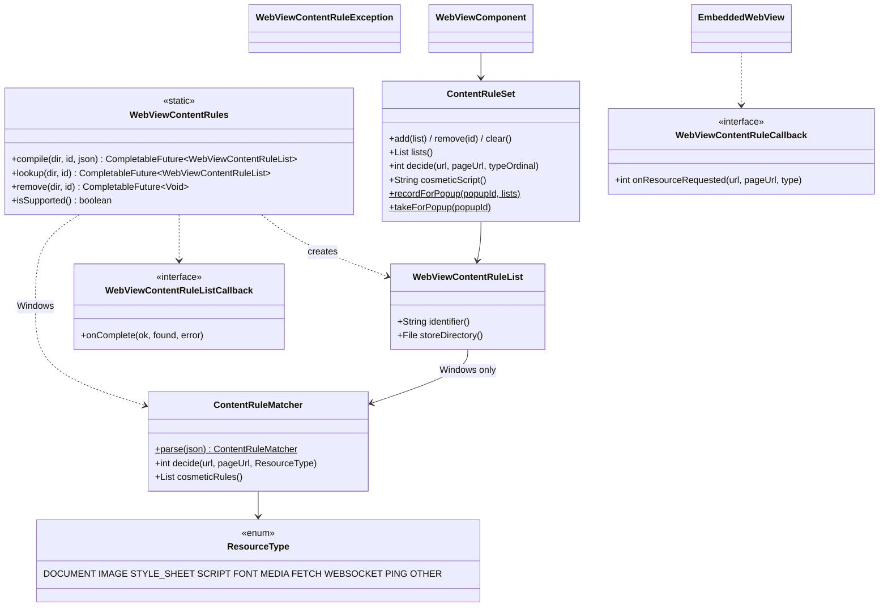

# REASONS Canvas: Block Content With Rule Lists — Java API, Linux, macOS and Windows (013-001)

> Source story: `requirements/[User-story-13]block-content-with-rule-lists.md` → **[STORY-013-001]**.
> Analysis: `spdd/analysis/GGQPA-XXX-202611031200-[Analysis]-block-content-with-rule-lists.md`.
>
> One Canvas for all three engines, like Canvas 34: the value is one portable rule format. It follows
> Canvas 34's shape for the per-component wiring (callback, global ref, attach-before-first-navigate) and
> Canvas 30's for process-global state (schemes).

## REASONS-Implements

**Java (`src/ca/weblite/webview/`)**
- **New:**
  - `WebViewContentRuleList`: the immutable handle of a compiled list (D1);
  - `WebViewContentRules`: compile, look up, remove, and the support probe (D2, D3);
  - `WebViewContentRuleException`: why a compile, lookup or remove failed (D2);
  - `WebViewContentRuleListCallback`: the JNI-facing completion interface (D4);
  - `WebViewContentRuleCallback`: the JNI-facing per-request interface, Windows only (D9);
  - `ContentRuleMatcher`: the portable parser, validator and matcher of the JSON format (D10);
  - `ContentRuleSet`: a component's ordered applied lists, and the request decision and cosmetic script
    over them (D6, D9, D11).
- **Edited:**
  - `WebViewNative`: the natives in D4, D5 and D9;
  - `EmbeddedWebView` and `OffscreenWebView`: `addContentRuleList`, `removeContentRuleList`,
    `removeAllContentRuleLists`, `setContentRuleCallback`, `setContentRuleScript` (D5, D9);
  - `PopupDispatcher`: records the opener's applied lists for each adoptable popup (D7);
  - `swing/WebViewComponent`: the component API, the popup seeding, and `isContentRuleListSupported()`
    (D6, D7);
  - `swing/WebViewHeavyweightComponent` and `swing/WebViewLightweightComponent`: replay the applied lists
    at attach, before the first navigation (D6).

**Native**
- **Edited** `src_c/webkit_loader.h` and `src_c/webkit_shim.h`: the optional filter-store symbols (D8).
- **Edited** `src_c/webview_embed.cpp`: the GTK filter store and apply (D8), the Cocoa rule list store,
  apply and popup inheritance (D12), and the JNI bridges (D4, D5).
- **Edited** `windows/webview_embed.cc`: the request hook, the cosmetic script slot, popup inheritance and
  the JNI bridges (D9, D13).

**Tests (JUnit 4, headless)**
- **New** `test/ca/weblite/webview/ContentRuleMatcherTest.java` and
  `test/ca/weblite/webview/ContentRuleSetTest.java`.

**Demo and docs**
- **New** `demos/WebViewContentRulesDemo`, `run-linux-content-rules-demo.sh`,
  `run-mac-content-rules-demo.sh` and `run-windows-content-rules-demo.bat`.
- **Edited** `README.md`.

## Decisions (resolved here)

- **D1 · `WebViewContentRuleList`** is an immutable value: `identifier()` (non-empty), `storeDirectory()`
  (an absolute `File`). Two handles are equal when both match. It holds no native pointer: native code keys
  its registry by `storeDirectory + "\n" + identifier` (D4). On Windows it also carries the parsed
  `ContentRuleMatcher` (package-private accessor `matcher()`), null elsewhere.

- **D2 · `WebViewContentRules`** (static, final, no instances):
  - `CompletableFuture<WebViewContentRuleList> compile(File storeDirectory, String identifier, String json)`
    — compiles and stores under `identifier`, replacing any list stored under it. Completes
    exceptionally with `WebViewContentRuleException` (message: the engine's reason) on invalid input, an
    unsupported runtime or an I/O failure.
  - `CompletableFuture<WebViewContentRuleList> lookup(File storeDirectory, String identifier)` — completes
    with the stored list, or with **null** when none is stored under that name.
  - `CompletableFuture<Void> remove(File storeDirectory, String identifier)` — removes it from the store
    (completes normally when nothing was stored). Components that applied it keep it until removed from
    them.
  - `boolean isSupported()` — D3.
  - **Argument checks** (throw `IllegalArgumentException` / `NullPointerException` synchronously): non-null
    directory, identifier and json; identifier matches `[A-Za-z0-9._-]{1,128}` (it becomes a file name on
    every engine).
  - The directory is created if missing (`mkdirs`), and made absolute.
  - **Futures complete off the EDT** (on the native completion thread or a worker), never on the AppKit
    main thread synchronously inside the native call.

- **D3 · Support.** `isSupported()` answers `WebViewNative.webview_content_rules_available()`, false on
  `UnsatisfiedLinkError`. Native answers: macOS true; Windows true; Linux true when the optional filter-store
  symbols resolved (WebKitGTK ≥ 2.24). `compile`/`lookup` on an unsupported runtime complete exceptionally;
  `remove` completes normally. A component's `addContentRuleList` on an unsupported runtime records the list
  and does nothing else (AC11).

- **D4 · The store natives (macOS and Linux).**
  - `static native void webview_content_rules_compile(String dir, String id, String json, WebViewContentRuleListCallback cb)`;
  - `static native void webview_content_rules_lookup(String dir, String id, WebViewContentRuleListCallback cb)`;
  - `static native void webview_content_rules_remove(String dir, String id, WebViewContentRuleListCallback cb)`;
  - `WebViewContentRuleListCallback.onComplete(boolean ok, boolean found, String error)` is called **exactly
    once**, on a native thread attached to the JVM (never inside the JNI call itself). `found` is false only
    for a lookup that found nothing (`ok` true) or a remove of a missing list.
  - Native keeps a process-global **registry** `key → compiled list` (retained `WKContentRuleList` /
    referenced `WebKitUserContentFilter`), filled by a successful compile or lookup and emptied by remove.
    It also keeps one store object per directory.
  - On Windows these natives are not used: `WebViewContentRules` does the work in Java (D10): compile
    validates and parses, then writes `<dir>/<id>.json` atomically (temp file + rename); lookup reads and
    parses it; remove deletes it. Parsing runs on a worker thread (`ForkJoinPool.commonPool()` via
    `CompletableFuture.supplyAsync`). A Java registry keeps the parsed matcher by key.

- **D5 · Apply natives (macOS and Linux).**
  - `webview_embed_add_content_rule_list(long, String dir, String id)`,
    `webview_embed_remove_content_rule_list(long, String dir, String id)`,
    `webview_embed_remove_all_content_rule_lists(long)`, and the same three as `webview_offscreen_*` (GTK
    `OffEngine`).
  - Each runs on the engine's UI thread in the engine's FIFO dispatch, so an add issued before `navigate`
    takes effect before the first request.
  - Adding a key the registry does not hold logs and does nothing. Adding a key already applied replaces it
    (both WebKits key by identifier).
  - The native filter identifier is the registry key's identifier part; two stores with the same identifier
    applied to one view collide (documented: use distinct identifiers).

- **D6 · `WebViewComponent` API.**
  - `addContentRuleList(WebViewContentRuleList list)`, `removeContentRuleList(String identifier)`,
    `removeAllContentRuleLists()`, `List<WebViewContentRuleList> getContentRuleLists()` (unmodifiable, in
    order), `static boolean isContentRuleListSupported()` (= `WebViewContentRules.isSupported()`).
  - The component's lists live in a `ContentRuleSet` (ordered; re-adding an identifier moves it to the end).
  - **Before attach**, calls only record. **At attach**, both components replay the set to the peer
    **before** the first `navigate` and before an adopted popup is shown: on macOS/Linux one native add per
    list; on Windows the content-rule callback and the cosmetic script (D9, D11).
  - **After attach**, each call records and forwards (macOS/Linux: the matching native call; Windows:
    reinstall the cosmetic script, and install or clear the callback when the set becomes non-empty or
    empty).
  - Changes govern the next request; already-loaded resources are not re-evaluated (AC8 reloads).
  - Thread: any thread; the set is guarded by its own lock.

- **D7 · Popups (AC9).**
  - **Native inheritance before the first request:** GTK children share the opener's user content manager
    (`webkit_web_view_new_with_related_view`), so they inherit natively; Cocoa copies the opener's applied
    lists onto the child's controller at creation (D12); Windows gives the child engine the opener's
    content-rule callback and cosmetic script (D13).
  - **Java seeding:** `PopupDispatcher.dispatchPopupAdoptable` records `popupId → opener's lists` in a
    static, bounded map (`ContentRuleSet.recordForPopup`, newest 64, entries consumed once).
    `WebViewComponent.adoptPopup(mode, popupId)` seeds the new component's set from it, so the adopted
    component reports and owns the same lists and replays them at attach (idempotent with the native
    inheritance).
  - **Linux shared manager:** a list removed from an adopted GTK popup is removed from its opener too, and
    vice versa (documented in Javadoc; GTK offers no per-view manager for related views).

- **D8 · Linux (WebKitGTK).**
  - **Loader:** an optional group `WK_OPT_FILTERS` (gated `WEBKIT_CHECK_VERSION(2, 24, 0)`) adds
    `webkit_user_content_filter_store_new`, `_save`, `_save_finish`, `_load`, `_load_finish`, `_remove`,
    `_remove_finish`, `webkit_user_content_filter_ref`, `webkit_user_content_filter_unref`,
    `webkit_user_content_manager_add_filter`, `webkit_user_content_manager_remove_filter_by_id` and
    `webkit_user_content_manager_remove_all_filters`. Available iff every one resolved (`gtk_filters_ok()`).
  - **Store:** `std::map<std::string, WebKitUserContentFilterStore*>` by directory, created on the GTK
    thread. The JSON is passed as `GBytes` (`g_bytes_new`).
  - **Async:** compile/lookup/remove are started on the GTK thread with `GtkPump::run_async`; their
    `GAsyncReadyCallback` finishes, updates the registry (ref'ing the filter), and hands the upcall to a
    detached `std::thread` that attaches to the JVM, calls `onComplete`, deletes the callback's global ref
    and detaches. A lookup's `G_IO_ERROR`/`WEBKIT_USER_CONTENT_FILTER_ERROR_NOT_FOUND` (code 1) answers
    `ok=true, found=false`; other errors answer `ok=false` with the `GError` message.
  - **Apply:** `webkit_user_content_manager_add_filter(e->manager, filter)`,
    `_remove_filter_by_id(e->manager, id)`, `_remove_all_filters(e->manager)` on the GTK thread, for both
    `Engine` and `OffEngine`.
  - **D8a · Linux is lightweight only.** Verification runs the lightweight component (`OffEngine`); the
    GTK `Engine` path carries the same calls only so the two GTK engines stay alike (as in Canvas 34 D7a).

- **D9 · Windows request hook.**
  - `WebViewContentRuleCallback.onResourceRequested(String url, String pageUrl, int resourceType)` returns
    an `int`: `0` allow, `1` block, `2` block cookies. `resourceType` uses the ordinals in D10's
    `ResourceType` (a wire contract).
  - `webview_embed_set_content_rule_callback(long, WebViewContentRuleCallback)` stores one global ref
    (replaced on set, deleted on destroy) and, on the WebView2 thread in FIFO order, adds the filter
    `AddWebResourceRequestedFilter(L"*", COREWEBVIEW2_WEB_RESOURCE_CONTEXT_ALL)` once per webview when the
    callback is non-null. The filter is never removed (removing `*` could drop the scheme hook's
    registrations sharing the pattern); a null callback makes the handler inert.
  - **`ContentRuleRequestHandler`** (an `ICoreWebView2WebResourceRequestedEventHandler`, registered at
    engine creation beside the navigation handler and on an adopted child):
    - with no callback, returns `S_OK`;
    - reads the URI; ignores (returns) unless the scheme is `http`, `https`, `ws` or `wss`;
    - reads `get_ResourceContext` and maps it to `ResourceType`;
    - `pageUrl` is the URI itself for a `DOCUMENT` request, else the engine webview's `get_Source`;
    - calls Java synchronously on the WebView2 thread (attach if needed; clear a pending exception and allow
      — **fail open**, because a matcher bug must not break browsing; the throwable is described);
    - `1` → `put_Response` with `CreateWebResourceResponse(nullptr, 403, L"Blocked by content rules", L"")`
      from the engine's `environment`; `2` → removes the `Cookie` request header.
  - **Java side**: the component installs a callback that answers `ContentRuleSet.decide(url, pageUrl,
    type)` — never throws (a throwable answers `0` and goes to the uncaught handler).

- **D10 · `ContentRuleMatcher`** (package-private, platform-independent, Java 8):
  - **Parses** the JSON with a small private recursive-descent reader (objects, arrays, strings with all
    escapes, numbers, booleans, null). Top level must be a non-empty array of objects.
  - **Validates** like WebKit, failing compile with `WebViewContentRuleException` naming the rule index:
    each rule has `trigger` and `action` objects; `trigger.url-filter` is a string that compiles as a
    `java.util.regex.Pattern`; `action.type` is one of `block`, `block-cookies`, `css-display-none`,
    `ignore-previous-rules`, `make-https`, `notify`; `css-display-none` has a non-empty `selector`;
    `if-domain`/`unless-domain` are not both present, nor `if-top-url`/`unless-top-url`; arrays hold
    strings; `resource-type` and `load-type` values are known; more than 150,000 rules fails.
  - **Triggers honoured:** `url-filter` (+ `url-filter-is-case-sensitive`, default false), `if-domain` /
    `unless-domain` (lower-cased; a leading `*` also matches subdomains) matched against the **page** host,
    `if-top-url` / `unless-top-url` (regex on the page URL), `resource-type`, `load-type`, `load-context`
    (only `top-frame` can be known: a rule limited to `child-frame` never matches on Windows).
  - **`ResourceType`** enum, ordinals as wire contract: `DOCUMENT(0) IMAGE(1) STYLE_SHEET(2) SCRIPT(3)
    FONT(4) MEDIA(5) FETCH(6) WEBSOCKET(7) PING(8) OTHER(9)`. Mapping from WebView2 contexts: `DOCUMENT`,
    `IMAGE`, `STYLESHEET`, `SCRIPT`, `FONT`, `MEDIA` direct; `XML_HTTP_REQUEST`, `FETCH`,
    `EVENT_SOURCE` → `FETCH`; `WEBSOCKET` → `WEBSOCKET`; `PING`, `CSP_VIOLATION_REPORT` → `PING`; anything
    else → `OTHER`. A rule's `resource-type` matches `FETCH`/`WEBSOCKET`/`OTHER` through `raw` as well as
    `fetch`/`websocket`/`other`; `svg-document` matches `DOCUMENT`; `popup` never matches a request.
  - **First/third party:** registrable domains compared; an IP literal or single-label host is its own
    domain; otherwise the last two labels, or three when the second-to-last label is one of `co com net org
    gov edu ac or ne go` and the top-level label has two letters (documented approximation of the public
    suffix list).
  - **Actions applied** (`decide`), **per list, as WebKit does** (each list is its own content extension):
    within one list, in rule order, a matching `ignore-previous-rules` clears that list's accumulated
    decision; `block` sets block; `block-cookies` sets block-cookies unless block; `make-https` and `notify`
    are accepted and ignored on Windows (documented); `css-display-none` does not affect requests. Across
    lists, the request is blocked when any list blocks, else has cookies blocked when any list says so.
  - **Index:** the *required literal text* of a `url-filter` is every maximal run of literal characters
    outside `[...]` classes and `(...)` groups, excluding a character followed by `?`, `*` or `{`, and broken
    by `.`, `^`, `$`, `+` (after its character), escapes of letters/digits (`\d`, `\w`…) and anything else
    that is not a literal; an escaped punctuation character (`\.`, `\/`, `\?`…) is literal. A pattern with a
    top-level `|` has none. Each rule whose required literal text has a 3-character run is filed under the
    **rarest** lower-cased 3-gram of its runs (rarity counted over the list); others go to a generic bucket.
    A request collects candidates from the buckets of every 3-gram of its lower-cased URL plus the generic
    bucket, de-duplicated and sorted by rule index, then evaluates them in order. Correct by construction:
    a URL the pattern matches contains its required literal text, so it contains the chosen 3-gram.
  - **Cosmetic export:** `cosmeticRules()` yields the `css-display-none` and `ignore-previous-rules` rules,
    in order, with their url-filter, case-sensitivity and domain/top-url conditions, for D11.

- **D11 · Windows cosmetic script.**
  - `webview_embed_set_content_rule_script(long, String js)` replaces one dedicated document-created script
    per webview: on the WebView2 thread it removes the previous script id
    (`RemoveScriptToExecuteOnDocumentCreated`) and adds the new one (its id stored from the completion
    handler); an empty string just removes it.
  - `ContentRuleSet.cosmeticScript()` builds it: a self-invoking function holding the cosmetic rules of all
    applied lists as JSON data (consecutive unconditional `css-display-none` rules — url-filter `.*` or
    `^https?://`-prefixed match-all forms, no conditions — merged into one entry). At run time it takes the
    page URL (`location.href` in the top frame; in a frame, the last entry of `location.ancestorOrigins`
    when present, else its own), evaluates each list's entries in order (an `ignore-previous-rules` match
    clears the selectors that list collected so far), and inserts one `<style>` with `sel{display:none!important}` per selector
    group through `CSSStyleSheet.insertRule` in try/catch per group (one invalid selector never drops the
    others). It inserts into `document.documentElement` at once if present, else on the first DOM mutation.
  - With no lists, the component sets the empty script.

- **D12 · macOS (WKWebView).**
  - **Store:** `+[WKContentRuleListStore storeWithURL:]` per directory (`fileURLWithPath:isDirectory:YES`),
    cached; all store calls run on the AppKit main thread via `cocoa_run_on_main_async`.
  - `compileContentRuleListForIdentifier:encodedContentRuleList:completionHandler:`,
    `lookUpContentRuleListForIdentifier:completionHandler:`,
    `removeContentRuleListForIdentifier:completionHandler:` with clang blocks `^(id list, id error)` /
    `^(id error)`. Success retains the list into the registry; lookup's error with code
    `WKErrorContentRuleListStoreLookUpFailed` (6) answers `ok=true, found=false`; remove's
    `WKErrorContentRuleListStoreRemoveFailed` (7) answers `ok=true, found=false`; other errors answer the
    `localizedDescription`.
  - The upcall runs on a detached `std::thread` (attach, call, delete the global ref, detach).
  - **Apply:** `addContentRuleList:` / `removeContentRuleList:` / `removeAllContentRuleLists` on
    `e->manager`. The engine records applied keys in `e->content_rule_keys` (ordered vector).
  - **Popups:** at child creation (both `ADOPT` and `NATIVE_WINDOW`), every key in the opener's
    `content_rule_keys` still in the registry is added to `child_e->manager` and recorded on `child_e`,
    before the child's first request.

- **D13 · Windows popups and lifecycle.**
  - A child engine (adopted or window) copies the opener's content-rule callback global ref and cosmetic
    script text at creation, registers `ContentRuleRequestHandler`, adds the `*` filter when the callback is
    set, and adds the script, before the child's request proceeds (inside the `NewWindowRequested`
    deferral, as the UA hook does).
  - Destroy deletes the callback global ref with the others.

## R · Requirements
- Let an application stop matching requests in the engine, before they are sent, and hide matching
  elements, with one rule format on every platform.
- Compile once, keep the result, apply per component, inherit into popups.
- Change nothing for applications that apply no list.

## E · Entities

## A · Approach
1. **Native compilation where the engine has it**, keyed by (directory, identifier); Java never holds a
   native pointer.
2. **Java matching on Windows**, synchronously from the request hook, with a token index; hide rules by one
   replaceable injected script.
3. **The Canvas 34 attach discipline**: buffered on the component, replayed before the first navigate,
   inherited by popups natively and seeded in Java.
4. **Fail open on Windows request matching** (a matcher bug must not break pages); **fail loudly at compile
   time** (invalid lists never apply).

## S · Structure
1. Public types sit in `ca.weblite.webview` beside the navigation types; `ContentRuleMatcher` and
   `ContentRuleSet` are package-private except where the `swing` package needs them (`ContentRuleSet` is
   public with a `@hidden`-style Javadoc note, like `NavigationDispatcher`).
2. Native code: one block per platform next to the navigation code; JNI bridges next to the navigation
   bridges, inside the `extern "C"` block where new methods without header prototypes live.

## O · Operations
1. **`WebViewContentRuleException`, `WebViewContentRuleList`, the two callback interfaces**, per D1, D4, D9.
2. **`ContentRuleMatcher`** (+ `ResourceType`), per D10.
3. **`ContentRuleSet`**, per D6, D7, D9, D11.
4. **`WebViewContentRules`**, per D2–D4 (Windows path in Java).
5. **`WebViewNative`, `EmbeddedWebView`, `OffscreenWebView`**, per D4, D5, D9, D11; each wrapper catches
   `UnsatisfiedLinkError`.
6. **`WebViewComponent`, both components, `PopupDispatcher`**, per D6, D7.
7. **Linux**, per D8; **macOS**, per D12; **Windows**, per D9, D11, D13.
8. **Tests:**
   - `ContentRuleMatcherTest`: parse errors (not an array, empty, missing trigger/action, bad regex, unknown
     action, css without selector, both if/unless-domain); block by url-filter; case sensitivity;
     `if-domain` / `unless-domain` with and without `*`; `resource-type` incl. `raw` for fetch;
     `load-type` first/third party incl. `co.uk`; `ignore-previous-rules` cancels block; `block-cookies`;
     the index finds a `||domain^`-style rule (`^[^:]+:(//)?([^/]+\.)?example\.com[/:]`) and a generic one;
     required literal text of representative patterns; 50,000 synthetic rules
     decide 1,000 URLs in under one second.
   - `ContentRuleSetTest`: order and re-add moves to end; decide across two lists (a later list's
     `ignore-previous-rules` does not unblock an earlier list's block; within one list it does); cosmetic script contains merged selectors and is empty with no lists; popup
     record/take once, bounded to 64.
9. **Demo and README**: `WebViewContentRulesDemo` serves a page from `http://localhost:8124/` (a local
   `HttpServer`) with `/ads/` and `/ok/` images, an `/ads/` script, a third-party script from
   `127.0.0.1:8124`, a fetch button and `.ad-slot` divs; it compiles a demo list into a temp store, applies
   it, and logs every request the server receives. `DEMO_AUTO=1` loads, waits, prints `HITS:` and the
   computed visibility of `.ad-slot`, and exits.
10. **Verification recorded in the PR:** the Linux native built and the demo run under Xvfb **in the
    lightweight component**; CI compiling the macOS and Windows natives; JUnit green.

## N · Norms
1. Javadoc on every public type states threading and failure behaviour; comments cite `Canvas 37 Dn`.
2. Native upcalls never throw into native; JNI exceptions are described and cleared.
3. Java 8 source level, no new dependency.
4. Every new native function has the same three-platform symmetry as Canvas 34 (stubs where an engine has
   no offscreen variant).

## S · Safeguards
1. **Before the request**: on every engine the block happens before bytes are sent.
2. **No behaviour change without a list**: no Windows filter is added and no script injected until a list
   is applied; no GTK/Cocoa call is made.
3. **Invalid lists never apply**: compile fails, nothing is registered.
4. **No new mandatory dependency**: the Linux symbols are optional; an older WebKitGTK reports unsupported.
5. **Windows fails open per request**; compile fails closed.
6. **Identifiers are file-name safe** (D2) on every engine.
7. **Bounded memory**: popup seeding map newest 64; the registry only holds lists the application
   compiled or looked up.
