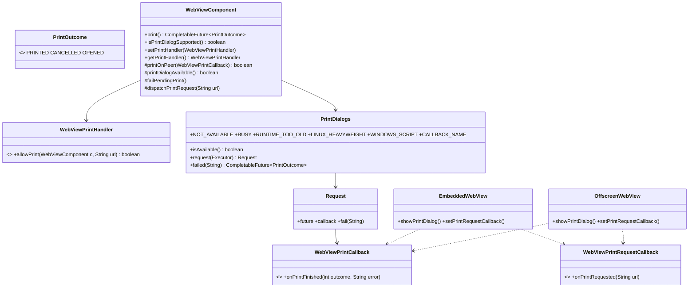

# REASONS Canvas: Print A Page Through The Native Print Dialog (014-001)

> Source story: `requirements/[User-story-14]print-a-page-through-the-native-print-dialog.md` →
> **[STORY-014-001]**. STORY-014-002 (the macOS PDF holds every page) is Canvas 29 D9, amended.
> Analysis: `spdd/analysis/GGQPA-XXX-202611091400-[Analysis]-print-a-page-through-the-native-print-dialog.md`.
>
> A sibling of [[29-Print-A-Page-To-Pdf]]: one asynchronous engine operation on all three platforms,
> answered through a one-shot callback object — but the operation is the **engine's own print dialog**,
> and the answer is the person's (printed / cancelled), not a file. Plus the page's own
> `window.print()`, routed to the application in the shape of the permission handler
> ([[35-Decide-Camera-Microphone-And-Screen-Capture-Requests]]).

## REASONS-Implements

- `src/ca/weblite/webview/PrintOutcome.java` — **new**: `PRINTED`, `CANCELLED`, `OPENED`.
- `src/ca/weblite/webview/WebViewPrintCallback.java` — **new**: the one-shot native → Java answer.
- `src/ca/weblite/webview/WebViewPrintRequestCallback.java` — **new**: native → Java "the page called
  `window.print()`".
- `src/ca/weblite/webview/WebViewPrintHandler.java` — **new**: the application's decision.
- `src/ca/weblite/webview/PrintDialogs.java` — **new**: the capability probe, messages, the one-shot
  request (callback → `CompletableFuture<PrintOutcome>`), the Windows `window.print` script.
- `src/ca/weblite/webview/WebViewNative.java` — **edited**: five native declarations.
- `src/ca/weblite/webview/EmbeddedWebView.java` — **edited**: `showPrintDialog()`,
  `setPrintRequestCallback(…)`.
- `src/ca/weblite/webview/OffscreenWebView.java` — **edited**: the same.
- `src/ca/weblite/webview/swing/WebViewComponent.java` — **edited**: `print()`,
  `isPrintDialogSupported()`, `setPrintHandler`/`getPrintHandler`, the `printOnPeer` hook, one-at-a-time
  and pending tracking, the page-request dispatch.
- `src/ca/weblite/webview/swing/WebViewHeavyweightComponent.java` — **edited**: the hook, the request
  callback at attach, the Windows script, failing a pending print on teardown.
- `src/ca/weblite/webview/swing/WebViewLightweightComponent.java` — **edited**: the hook, the request
  callback at attach, failing a pending print on teardown.
- `src_c/webkit_loader.h`, `src_c/webkit_shim.h` — **edited**: `webkit_print_operation_run_dialog`.
- `src_c/webview_embed.cpp` — **edited**: the GTK (offscreen) and Cocoa dialogs, the GTK `print` signal,
  the Cocoa `window.print` delegate selectors, the upcalls, five JNI exports in the `extern "C"` block.
- `windows/webview_embed.cc` — **edited**: `ShowPrintUI`, the five JNI exports.
- `test/ca/weblite/webview/PrintDialogsTest.java`,
  `test/ca/weblite/webview/swing/WebViewComponentPrintTest.java` — **new**.
- `demos/WebViewPrintDemo/…`, `run-linux-print-demo.sh`, `run-mac-print-demo.sh`,
  `run-windows-print-demo.bat` — **new**: a four-page sample, a Print button in Swing and a
  `window.print()` button in the page.
- `README.md` — **edited**: a "Print with the native dialog" section and the demo.

## Decisions (resolved here)

- **D1 · The answer.** `print()` returns `CompletableFuture<PrintOutcome>`, completed **on the EDT** with
  `PRINTED` (the person confirmed: a printer, Save as PDF, Open in Preview), `CANCELLED`, or `OPENED`
  (the dialog opened and the engine reports nothing more — WebView2), or exceptionally with an
  `IOException` whose message is the reason. The native side answers a `WebViewPrintCallback`
  `onPrintFinished(int outcome, String error)` exactly once (`outcome` = ordinal, or `-1` with `error`).
- **D2 · The dialog is the platform's.** The library sets nothing the person chooses: no paper, range,
  copies, margins or scale. It prints the whole document from the top whatever the scroll position.
  - **macOS**: `printOperationWithPrintInfo:` with a copy of `[NSPrintInfo sharedPrintInfo]` (automatic
    pagination, not centred), `setShowsPrintPanel:YES`, `setShowsProgressPanel:YES`,
    `setCanSpawnSeparateThread:YES`, the print panel's options = copies | page range | paper size |
    orientation | scaling | preview (`NSPrintPanelShowsCopies|…|ShowsPreview` = `0x1|0x2|0x4|0x8|0x10|
    0x20000`), the operation view's frame = the WKWebView's bounds, run with
    `runOperationModalForWindow:delegate:didRunSelector:contextInfo:` on the view's window (a sheet; the
    main thread keeps running). `success` YES → `PRINTED`, NO → `CANCELLED`.
  - **Windows**: `ICoreWebView2_16::ShowPrintUI(COREWEBVIEW2_PRINT_DIALOG_KIND_BROWSER)` → `OPENED` when
    it returns `S_OK`. Without `ICoreWebView2_16`: "Printing needs a newer WebView2 runtime."
  - **Linux (lightweight)**: a new `WebKitPrintOperation` for the view, `webkit_print_operation_run_dialog(
    op, NULL)` on the GTK thread → `WEBKIT_PRINT_OPERATION_RESPONSE_PRINT` → `PRINTED`, else
    `CANCELLED`; the operation's `failed` signal, if it fires first, answers with its message.
    Heavyweight on Linux refuses with "Printing on Linux needs the lightweight WebView component." (as
    Canvas 29 D13).
- **D3 · Capability.** `webview_print_dialog_available()` → true on macOS, Windows and GTK natives with
  this feature; `PrintDialogs.isAvailable()` absorbs `Throwable` → false (older natives, no natives).
  `WebViewComponent.isPrintDialogSupported()` returns it. A `print()` against an unavailable native fails
  at once with `NOT_AVAILABLE = "Printing is not available in this version of the native library."`.
- **D4 · One dialog per component.** While a `print()` future is unfinished, another `print()` on the
  same component fails at once with `BUSY = "A print is already in progress."`; the open dialog is
  untouched. On Windows the future finishes when the dialog opens, so this holds until then.
- **D5 · No peer, no dialog; teardown answers.** No attached peer → `NOT_ATTACHED` ("The WebView is not
  attached yet.", shared with Canvas 29). A component disposed while a print is unfinished fails it with
  `CLOSED` ("The WebView was closed."); a native answer arriving after that is ignored (the request
  completes at most once).
- **D6 · The page's `window.print()`.** Every engine reports a page's print request to a per-engine
  `WebViewPrintRequestCallback.onPrintRequested(String url)` (the main frame's address; fire-and-forget,
  on any thread). The component dispatches on the EDT: no `WebViewPrintHandler` → `print()`; a handler →
  `handler.allowPrint(component, url)` true → `print()`, false → nothing. A request that arrives while a
  print is in progress is dropped (D4). The future of a page-initiated `print()` is not exposed; its
  failures are written to stderr in one line, `[webview] print: <reason>`.
  - **macOS**: WKWebView ignores `window.print()` unless its UI delegate implements a private selector.
    `WebviewEmbedUIDelegate` gains `_webView:printFrame:` (`v@:@@`) and
    `_webView:printFrame:pdfFirstPageSize:completionHandler:` (`v@:@@{CGSize=dd}@`). Both answer WebKit
    **at once** (the second calls its completion block before anything else) — the web process waits
    for the answer, and the dialog needs the web process to lay out pages — then upcall, asynchronously,
    with the WKWebView's URL. With no callback installed they only answer WebKit (inert, as before).
  - **Linux**: the WebKitWebView `print` signal (`gboolean (*)(WebKitWebView*, WebKitPrintOperation*,
    gpointer)`) — with a callback installed, upcall with the view's URI and return `TRUE` (WebKit's own
    dialog does not run); without one return `FALSE` (WebKit's default runs).
  - **Windows**: WebView2 has no event; it opens its own dialog for `window.print()` (the same dialog as
    D2). While a `WebViewPrintHandler` is installed, the heavyweight component adds, once, a
    document-start script `PrintDialogs.WINDOWS_SCRIPT` that replaces `window.print` with a call to the
    JavaScript callback `__swingwebviewPrint(location.href)` registered with `addJavascriptCallback`,
    which feeds the same dispatch. It applies from the next document; its `window.print()` returns
    before the dialog closes. Removing the handler leaves the script, which then allows every request.
- **D7 · Threads.** The EDT never waits for the person. macOS: the dialog is a sheet started from an
  async-on-main block; its answer is delivered asynchronously (like Canvas 29's
  `cocoa_pdf_finish_async`). Linux: `run_dialog` blocks the GTK thread (other GTK engines wait until the
  dialog closes; the EDT does not). Windows: `ShowPrintUI` is called on the engine's thread.
- **D8 · Independent of print-to-PDF.** The dialog does not use Canvas 29's queue; a PDF request may run
  while a dialog is open (each engine serialises its own work).

## R · Requirements

- Let a person print the page a WebView shows through the platform's own print dialog, with preview,
  printer, page range, copies, paper, orientation and scale, on macOS, Windows and Linux.
- Let a page's own Print button open that dialog, unless the application refuses.
- Tell the application how the dialog ended, never block the UI, and fail clearly where the engine
  cannot.

## E · Entities



## A · Approach

1. Canvas 29's shape: a component hook, an engine-wrapper method, one JNI entry per engine kind, a
   callback answered exactly once, a probe that absorbs older natives.
2. The dialog is each platform's own (D2); the library adds nothing but the answer.
3. Page requests: native hooks where they exist (macOS private delegate, GTK signal), a script only
   where none does and only while the application wants to decide (Windows).

## S · Structure

- Java API (`ca.weblite.webview.swing.WebViewComponent`) → engine wrappers
  (`EmbeddedWebView`, `OffscreenWebView`) → `WebViewNative` → `src_c/webview_embed.cpp` (Cocoa, GTK),
  `windows/webview_embed.cc` (WebView2).
- Shared plumbing in `PrintDialogs` (pure Java, unit-tested without natives).

## O · Operations

### 1. `PrintOutcome`, `WebViewPrintCallback`, `WebViewPrintRequestCallback`, `WebViewPrintHandler` (**new**)
Exactly as in Entities. `WebViewPrintHandler.allowPrint` runs on the EDT; Javadoc states the default
(no handler = allow) and the Windows caveat (D6).

### 2. `PrintDialogs` (**new**, `ca.weblite.webview`)
- Constants: `NOT_AVAILABLE`, `BUSY`, `RUNTIME_TOO_OLD = "Printing needs a newer WebView2 runtime."`,
  `LINUX_HEAVYWEIGHT`, `NOT_ATTACHED = PdfPrinting.NOT_ATTACHED`, `CLOSED = PdfPrinting.CLOSED`,
  `CALLBACK_NAME = "__swingwebviewPrint"`, `WINDOWS_SCRIPT` = an IIFE that, when
  `window.__swingwebviewPrintHooked` is unset, sets it and assigns `window.print = function(){ try {
  window.__swingwebviewPrint(String(location.href)); } catch (e) {} }`.
- `isAvailable()`: `WebViewNative.webview_print_dialog_available()` inside `catch (Throwable) → false`.
- `failed(reason)`, `request(Executor completeOn)` → `Request` with `future`, `callback`, `fail(reason)`:
  the first answer wins; `outcome` 0..2 → that `PrintOutcome`, anything else → `IOException(error, or
  "The page could not be printed.")`; completion runs on `completeOn`.
- `outcomeFor(int)` → the enum or null (package-visible for tests).
- `firstStringArg(String json)`: the first argument of a binding's JSON argument array when it is a
  string (`["…"]`, with `\"`, `\\`, `\/` unescaped), else `""`; null → `""`.

### 3. `WebViewNative` (**edited**)
```
native static boolean webview_print_dialog_available();
native static void webview_embed_print_dialog(long w, WebViewPrintCallback cb);
native static void webview_offscreen_print_dialog(long peer, WebViewPrintCallback cb);
native static void webview_embed_set_print_request_callback(long w, WebViewPrintRequestCallback cb);
native static void webview_offscreen_set_print_request_callback(long peer, WebViewPrintRequestCallback cb);
```
Commented with Canvas 38.

### 4. `EmbeddedWebView` / `OffscreenWebView` (**edited**)
- `CompletableFuture<PrintOutcome> showPrintDialog()`: unavailable → `failed(NOT_AVAILABLE)`; no peer →
  `failed(NOT_ATTACHED)`; else a `PrintDialogs.Request` completing on the calling thread's choice
  (`Runnable::run`), passed to the native call. Completes on the engine thread.
- `setPrintRequestCallback(WebViewPrintRequestCallback cb)`: stored; applied to the peer now if attached
  and on attach otherwise, the way `setPermissionCallback` is; the native call is wrapped in
  `catch (UnsatisfiedLinkError)` so an older native keeps working.

### 5. `WebViewComponent` (**edited**)
- `print()`: on any thread. Unavailable (`printDialogAvailable()`) → a failed `Request` with
  `NOT_AVAILABLE` completing on the EDT. Else a `Request` completing on the EDT; on the EDT: if another
  print is pending → fail with `BUSY`; else record it as the pending print, clear it when the future
  completes, and call `printOnPeer(request.callback)` — `false` → fail with `NOT_ATTACHED`.
- `protected boolean printOnPeer(WebViewPrintCallback cb)` → `false` in the base class.
- `protected boolean printDialogAvailable()` → `PrintDialogs.isAvailable()`.
- `protected void failPendingPrint()` → fail the pending print with `CLOSED`.
- `public static boolean isPrintDialogSupported()`.
- `setPrintHandler(handler)` / `getPrintHandler()`: a volatile field; `setPrintHandler` with a non-null
  handler calls the protected hook `onPrintHandlerInstalled()` (no-op in the base class).
- `protected final void dispatchPrintRequest(String url)`: on the EDT (hopping if needed): skip when a
  print is pending; handler null or `allowPrint(this, url)` true (a thrown exception = false, logged) →
  `print()` with failures logged `[webview] print: <reason>`.

### 6. Heavyweight / lightweight (**edited**)
- `printOnPeer`: the live engine's `showPrintDialog()` answering `cb.onPrintFinished(ordinal, null)` or
  `(-1, reason)`; `false` without an engine.
- At attach, beside `setPermissionCallback`: `engine.setPrintRequestCallback(url ->
  dispatchPrintRequest(url))`.
- Teardown: `failPendingPrint()` beside `failPendingPdf()`.
- Heavyweight only, Windows only: `onPrintHandlerInstalled()` → once per component,
  `addJavascriptCallback(PrintDialogs.CALLBACK_NAME, args -> dispatchPrintRequest(first arg as text))`
  and `addOnBeforeLoad(PrintDialogs.WINDOWS_SCRIPT)`.

### 7. Linux native (**edited**, `src_c/webview_embed.cpp`, GTK section)
- `webkit_loader.h`/`webkit_shim.h`: `webkit_print_operation_run_dialog`.
- `struct PrintJob { jobject cb; JavaVM *jvm; }`, `print_new_job(env, cb)`, `print_finish(job, outcome,
  err)`: attach, `onPrintFinished(II…)` lookup by name `(ILjava/lang/String;)V`, call, delete the ref,
  delete the job — exactly once; nothing thrown into Java (exceptions cleared).
- `gtk_print_dialog(get_web, job)`: on the GTK thread; no view → `NOT_ATTACHED`; `op =
  webkit_print_operation_new(view)`; connect `failed` → remember the message; `resp =
  webkit_print_operation_run_dialog(op, NULL)`; a remembered failure → fail with it; `PRINT` → `PRINTED`;
  else `CANCELLED`; unref.
- The offscreen engine gains `jobject print_request_callback`; `gtk_off_set_print_request_callback` swaps global refs; the `print`
  signal handler upcalls `onPrintRequested(String)` with `webkit_web_view_get_uri` and returns `TRUE`
  when the callback is set, `FALSE` otherwise. Teardown deletes the ref with the other callbacks.
- Exports: `webview_print_dialog_available` (true on GTK and Cocoa); `webview_embed_print_dialog` (GTK
  → `LINUX_HEAVYWEIGHT` sentence; Cocoa → `cocoa_print_dialog`); `webview_offscreen_print_dialog` (GTK
  → `gtk_print_dialog` with the off engine's view; else `NOT_ATTACHED`);
  `webview_embed_set_print_request_callback` (Cocoa; a no-op on GTK, whose heavyweight is
  unsupported);
  `webview_offscreen_set_print_request_callback` (GTK offscreen; else no-op).

### 8. macOS native (**edited**)
- `cocoa_print_dialog(Engine*, PrintJob*)`: async on main; no engine/view/window → `NOT_ATTACHED` /
  "The WebView has no window to print from."; no `printOperationWithPrintInfo:` → "Printing needs macOS
  11 or later."; build per D2; answer through a second runtime class `WebviewEmbedPrintDelegate` with
  `printOperationDidRun:success:contextInfo:` → `print_finish` asynchronously.
- `Engine` gains `jobject print_request_callback`; `cocoa_set_print_request_callback`; released in
  `cocoa_destroy_engine` with the others.
- `WebviewEmbedUIDelegate` gains the two private selectors of D6.

### 9. Windows native (**edited**)
- The same `PrintJob` helpers in `embed_win`.
- `webview_embed_print_dialog`: dispatch to the engine thread; no webview → `NOT_ATTACHED`;
  `QueryInterface(ICoreWebView2_16)` fails → `RUNTIME_TOO_OLD`; `ShowPrintUI(BROWSER)` `S_OK` → `OPENED`,
  else the `HRESULT` as "The print dialog could not be shown (0x…)."
- `webview_print_dialog_available` → true; `webview_offscreen_print_dialog` → `NOT_ATTACHED`; both
  `set_print_request_callback` exports → no-op (D6: WebView2 has no event).

### 10. Tests, demo, README (**new**/**edited**)
- `PrintDialogsTest`: outcome mapping; first answer wins; failure messages; default message;
  `WINDOWS_SCRIPT` names `CALLBACK_NAME` and guards against a second install.
- `WebViewComponentPrintTest` (a test double overriding `printDialogAvailable`/`printOnPeer`): not
  available → fails with `NOT_AVAILABLE`; no peer → `NOT_ATTACHED`; a second print while one is pending
  → `BUSY` and the first unaffected; `failPendingPrint` → `CLOSED`, a late answer ignored; outcome
  delivered on the EDT; `dispatchPrintRequest` with no handler prints, with a denying handler does not,
  with a throwing handler does not, and passes the URL.
- `WebViewPrintDemo`: four pages of numbered paragraphs, a Swing "Print…" button printing the outcome,
  a page button calling `window.print()`, a "Deny page prints" checkbox installing a denying handler.
  Scripts `run-{linux,mac}-print-demo.sh`, `run-windows-print-demo.bat`, modelled on the PDF demo's.
- README: a section after "Print to PDF".

## N · Norms

1. Javadoc and native comments cite `Canvas 38 Dn`.
2. Java 8 source level, as the rest of `src/`.
3. Every native answer path calls the callback exactly once; nothing throws into Java.
4. New exports live inside the existing `extern "C"` blocks.

## S · Safeguards

1. The EDT never waits for the person (D7).
2. A component never shows two dialogs at once (D4).
3. A denied page request never opens a dialog (D6).
4. An older native, a missing runtime interface, or a missing macOS selector fails or stays inert —
   never crashes (D3, D2, D6).
5. Canvas 29's PDF path is unchanged by this Canvas (D8).
